# Sentin8:Auth - Detailed Design Document

## 1. Scope & Context

Sentin8:Auth is the platform's **single identity plane**: the only issuer
of every token family, the only JWKS authority, the DCR registrar, the
RBAC substrate (roles, groups, nesting, membership provisioning API),
consent grants, sessions, MFA/passkeys, SSO federation, webhooks, and the
OID4VCI/SD-JWT wallet surface.

- **Owns** (schema `auth`): identity + credentials (users, sessions, app
  passwords, MFA factors/challenges, WebAuthn challenges, reset/verify
  tokens, enterprise connections, SSO sessions), OAuth clients (incl. DCR
  records, federated credentials, M2M thumbprints), M2M scope grants, RBAC
  (roles, user_roles, groups, group_members, group_roles, role_nesting),
  consent grants (FAPI 2.0), wallet credentials + regulatory overlays +
  security profiles, actor tokens, webhook endpoints/outbox/attempts,
  signing keys, and the DBX producer tables (`outbox`, `audit_journal`,
  `post_outbox`).
- **Does NOT own**: org/env business records (sys provisions those and
  calls back via the provisioning API), tenant app instances, Shield
  policy storage (sys's `policy_sets` is the substrate; auth runs an
  engine on it), invitations (proxied to sys), e-signature (QES delegated
  to bank8-payments - `signature_request` returns NOT IMPLEMENTED).

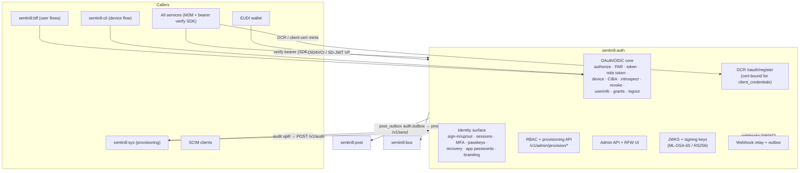

## 2. Runtime Architecture

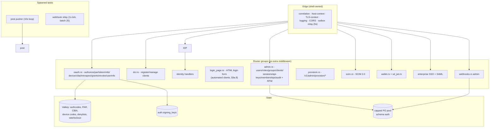

**Request lifecycle - authorization-code token issuance (FAPI 2.0
posture, platform profile):**

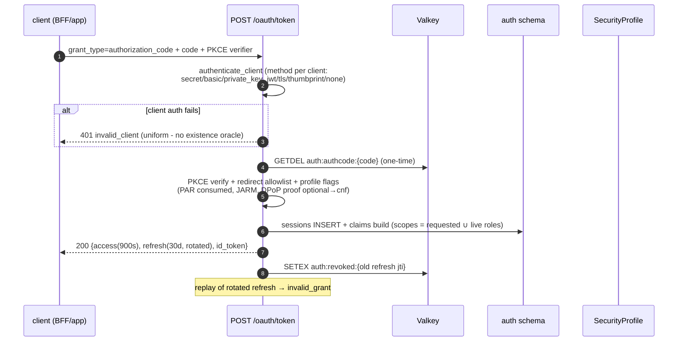

**M2M issuance (cert-bound, the platform identity path):**

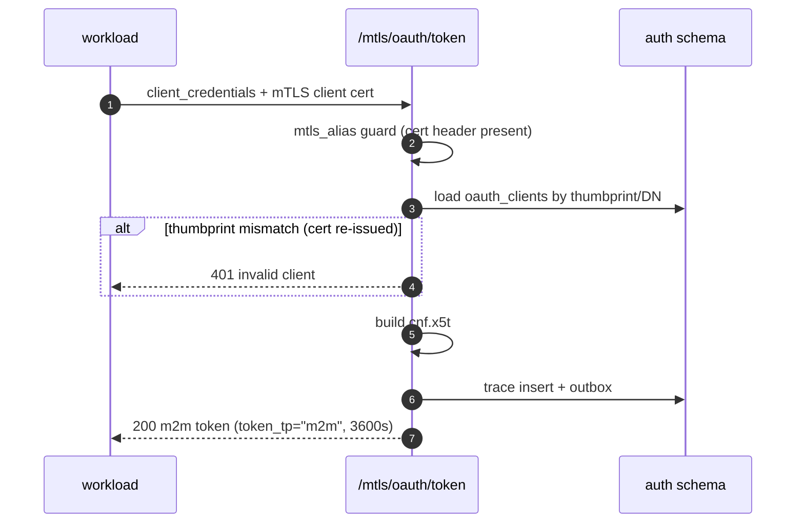

## 3. Data Model

```mermaid
erDiagram
    USERS ||--o{ SESSIONS : "holds"
    USERS ||--o{ USER_ROLES : "assigned"
    USERS ||--o{ GROUP_MEMBERS : "member of"
    USERS ||--o{ APP_PASSWORDS : "owns"
    USERS ||--o{ MFA_FACTORS : "enrolled"
    USERS ||--o{ ACTOR_EVENTS : "actor/target"
    ROLES ||--o{ USER_ROLES : "grants"
    ROLES ||--o{ GROUP_ROLES : "via groups"
    GROUPS ||--o{ GROUP_MEMBERS : "contains"
    GROUPS ||--o{ GROUP_ROLES : "binds"
    ROLE_NESTING {
        uuid parent_role_id PK
        uuid child_role_id PK
    }
    OAUTH_CLIENTS ||--o{ CLIENT_ROLES : "assigned"
    OAUTH_CLIENTS ||--o{ FEDERATED_CREDENTIALS : "federates"
    OAUTH_CLIENTS ||--o{ GRANTS : "consented"
    USERS ||--o{ CREDENTIALS : "wallet"
    USERS ||--o{ ENTERPRISE_CONNECTIONS : "SSO"
    WEBHOOK_ENDPOINTS ||--o{ WEBHOOK_OUTBOX : "queues"
    WEBHOOK_OUTBOX ||--o{ WEBHOOK_ATTEMPTS : "logs"
    USERS {
        uuid id PK
        string email
        string status "active|suspended|archived|locked"
        bool mfa_enabled
    }
    SESSIONS {
        string token_id UK
        string status "active|revoked|expired"
        timestamptz expires_at
    }
    OAUTH_CLIENTS {
        string client_id UK
        string token_endpoint_auth_method
        text[] grant_types
        string tls_client_auth_subject_dn
        string self_signed_tls_client_auth_thumbprint
        bool consent_required
        bool dpop_exempt
    }
    MFA_FACTORS {
        string factor_kind "totp|webauthn|backup_code"
        bytea secret_cipher "AES-encrypted"
        string status "pending|active|disabled"
    }
    CREDENTIALS {
        string format "sd_jwt"
        string status "active|revoked"
        jsonb cnf_jwk
    }
    SECURITY_PROFILES {
        string scope "platform|org|env"
        string profile "fapi_2|…"
        bool require_dpop
        int max_token_lifetime
    }
```

- **RLS**: FORCE RLS on all tenant tables (env policies; junctions carry
  their own `env_id` for direct RLS; `role_nesting` gated on the parent
  role's env). **No-RLS exceptions** (platform-internal): `m2m_dcr_credentials`
  (auth's own workloads only), `m2m_scope_grants` (anonymous DCR endpoint
  evaluates server-side), `webhook_attempts` (relay-written), and
  `actor_revocations` (`USING (true)` - revocation is jti-scoped, not
  env-scoped).
- **State machines**:

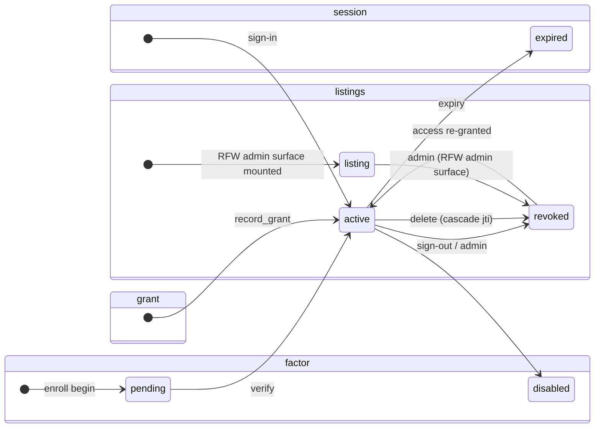

- **Secrets posture**: TOTP secrets, webhook secrets, client secrets are
  encrypted (`secret_cipher` BYTEA / hash); signing keys persisted
  AES-sealed under the master key; no plaintext secrets in any table.
- **OIDC claim data (address/phone, §9a.4)**: the `users` table carries
  `phone` and the postal-address columns
  (`street_address`, `locality`, `region`, `postal_code`, `country`) -
  written through the admin user surface (create/update), read at the
  ID-token/userinfo mint gated on the consented `phone`/`address` scopes.
  The OIDC `address` claim is the spec's JSON object
  (`formatted`/`street_address`/`locality`/`region`/`postal_code`/
  `country`), assembled at mint time from the columns.
- **Seeds**: platform admin user + the platform role/nesting catalog +
  `dash` (public PKCE, dpop_exempt) + `sentin8-cli` (device flow) clients.
  **Platform-admin contract (the `sentin8:sys:admin` role):** the role's
  OWN permissions are exactly `['sentin8:sys:admin']` - the marker scope
  that `is_platform_admin()` and the scope-mirror policies match on; its
  remaining scopes come from the NESTED service-admin roles
  (`dash:admin`, `auth:admin`, `db:admin`, …). The operator chain is
  `org:sys:admins` group → `sentin8:org:sys:admin` role → nested
  `sentin8:sys:admin` role → marker + closure. A seed that empties the
  role's own permissions severs the marker scope from every user - no
  one can be platform admin on a fresh apply (the bootstrap admin's
  sys:read/admin API calls then fail the scope-mirror policy).

## 4. API Surface

| Audience | Group | Gate |
|----------|-------|------|
| public | `/.well-known/*`, `/oauth/authorize(+continue)`, `/oauth/par`, `/oauth/token`, `/oauth/device`+`/device/verify`, `/oauth/userinfo`, `/oauth/logout`, `/oauth/login` (HTML form, §9a.8), `/v1/sign-in\|up\|out`, `/v1/branding`, `/v1/health` | session/cookie or client auth per flow; bot protection + lockout on sign-in |
| mTLS | `/mtls/oauth/token`, `/mtls/oauth/revoke` | cert-presence guard; client auth per DCR method - retained for out-of-band/tenant clients only; **platform workloads never fetch tokens (§4.3f)** |
| workload | `POST /oauth/register` (DCR) | interactive clients open; **client_credentials-only requires mTLS cert** + CN ∈ `m2m_scope_grants` + scopes ⊆ grant - retained for out-of-band tenant clients; platform workloads never DCR (§4.3f) |
| delegated | `POST /delegate/access-token` | verified M2M bearer + `sentin8:delegate:read` + cnf match |
| wallet | `/oauth/credentials*`, `/oauth/vp/response`, `/v1/auth/wallet/metadata` | bearer / VP verified (SD-JWT key binding + status list) |
| consent | `/v1/auth/consent/*` | session-validated; proxied to owning vertical |
| admin | `/v1/admin/{users,roles,groups,oauth-clients,api-keys,sessions,memberships,invitations,audit}` + RFW UI | `route_guard` + `require_sentin8or_access(_write)` + Shield |
| provisioning | `POST /v1/admin/provision/{role,role_nesting,group,group_role,group_member,user_role}` | admin bearer + `x-sentin8-target-env-id` header (env-scoped), idempotent upserts |
| SCIM | `/scim/v2/Users`, `/scim/v2/Groups`, metadata | `sentin8:scim:read`/`write` |
| security | `/v1/security-profile`, `/v1/admin/security` | admin bearer |
| webhooks | `/v1/admin/webhooks/{endpoints,outbox,attempts}` | Shield |
| health | `/v1/health` | none |
| MFA / passkey | `/v1/mfa/*`, `/v1/passkey/*` | bearer / session (+ rate limits) |
| recovery | `/v1/password/reset(+confirm)`, `/v1/email/verify(+confirm)` | none (enumeration-safe, token-gated confirm) |
| app passwords | `/v1/me/app-passwords` | self service (session/bearer) |
| CIBA | `/oauth/bc-authorize`, `/v1/ciba/*` | client auth on bc-authorize; session on approve/assisted |
| grants (FAPI 2.0 GM) | `/oauth/grants(/{id})` | user or admin per action |
| policy (Shield) | `/v1/admin/policy-sets(/{name})`, `/v1/admin/{relations,attributes}` | shield admin gate (`sentin8:admin`) |
| internal | `POST /v1/internal/keys/rotate` | admin (route-guard backstop) |

**OpenAPI spec.** The single source of truth for the served surface is the
`#[utoipa::path]` annotations on the handlers + the `#[openapi(paths(...))]`
list in `src/openapi.rs`; `docs/openapi.json` is the dumped artifact via
`--print-registration --section=openapi` (regenerated from the binary, never
hand-edited) and renders each service site's API reference page (sites
design §4.2). The generic Shield handlers cannot be pathed directly
(utoipa 5.5 resolves paths to non-generic `__path_` structs), so the inline
policy mount binds the annotated wrappers in `src/policy_docs.rs` and the
RFW POST-aliases bind `src/rfw_aliases.rs` (same operations, alias paths,
annotated per OAPEC design §2 rule 3).

**Tenant-aware issuer on every token mint (OIDC Core §3.1.3.7).** `iss`
is `https://auth.{env-domain}` - the tenant's own auth host, where the
env domain is **opaque** (the platform-derived `{env}.{org}.{tld}`
shape, a registered custom domain, anything the env owns - never
structurally parsed). Discovery already resolves it from
the TLS-injected `X-Sentin8-Hostname` (`resolve_issuer`); every mint
site (the ID token at code exchange and CIBA, and the access/refresh
family) resolves the same way so a tenant's tokens carry the tenant's
issuer. Token verification admits the `https://auth.*` issuer family
(the JWT signature - Auth is the single issuer - is the trust anchor;
the `iss` form is a sanity gate, never domain-coupled to the platform
TLD: a custom env domain must verify identically). The suite's
`ValidateIdToken` checks `iss` against the discovery issuer - a
process-constant issuer fails every tenant run (found live in the
OIDF rig: `iss=…ops.sys…` vs discovery `…cert.conformance-local…` →
`Issuer mismatch`).

**Drift guard.** `tests/openapi_drift.rs` asserts BOTH directions - every
served route appears in the compiled spec and every spec pair is served -
via the shared shell helper (`sentin8::shell::drift_guard`, router
introspection without HTTP round-trips; SPA fallback + `/openapi.json`
exempt per OAPEC §2 rule 8). A route added without an annotation fails the
test before the site pages can trail the routers.

**Event flow (outbox → Bus):**

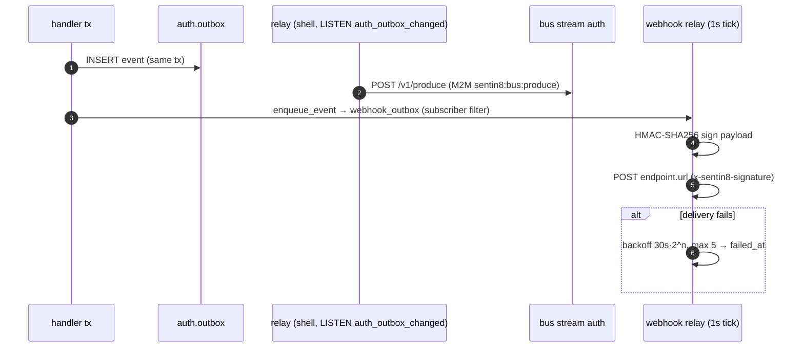

Event family `auth`; names `sentin8:auth:{user,role,group,client,credential,apikey,session,membership,dcr,connection,mfa,passkey,actortoken,securityprofile,webhook,grant,ciba}:{action}` - payload-complete envelopes. Session revocations
(`sign-out`, OAuth refresh-token revoke, password reset, admin terminate) emit
`sentin8:auth:session:revoked` - payload-complete envelope `{subject_id,
env_id, session_id, revoked_by, reason}` (continuous access evaluation,
README §7): the BFF session-reaper subscription (bff DESIGN §10) consumes the
`auth` family (group `bff-session-reaper`) and kills every cached BFF session
for the subject, so role/consent changes take effect immediately instead of at
the store TTL.

Grant lifecycle (FAPI 2.0 Grant Management, grants.rs): every standing
authorization emits its transition. Code issuance records/merges the grant
(`record_grant` at the authorization-code exchange) and emits
`sentin8:auth:grant:created` - payload `{grant_id, client_id, user_id,
env_id, scope, state, selected_account_ids}` where `state` is the client's
opaque OAuth state (the consent handle a vertical's consent flow packed into
PAR) and `selected_account_ids` are the accounts the customer selected on a
hosted consent screen. Downstream consent authorities (e.g. Bank8:FDX's
provider plane, fdx DESIGN §1) seed their data-holder grant ledgers from this
event - the authorization server is the seed of open-banking grant truth.
Grant revocation emits `sentin8:auth:grant:revoked`
(`{grant_id, user_id, client_id}`).

## 5. Cross-Cutting Concerns

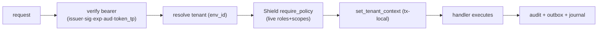

- **Token verification** is SDK-reused by every service
  (`sentin8::auth::client`) - auth is the only JWKS authority.
- **Rate limiting / bot protection**: IP 10/min, email 5/min sliding
  windows; 5 failures → durable `locked` status (config TTL); dummy bcrypt
  compare on unknown accounts (no email enumeration).
- **DPoP**: proof validation (htm/htu/iat/nonce/ath) with jti replay
  protection (SETNX 300s); `cnf.jkt` on access tokens; clients opt out via
  `dpop_exempt`.
- **FAPI 2.0 posture**: platform profile enforces PAR + JARM + DPoP +
  RFC 9449 issuer binding + 900s max token lifetime + refresh rotation;
  env/org profiles override (`security_profiles`).
- **Introspection honesty**: `none`-auth clients hard-rejected;
  JWT-introspection responses signed per profile.
- **Back-channel logout**: logout token issued to registered
  `backchannel_logout_uri` per client.

### 4.3f Token-free platform M2M (CERTFREE-1) - the certificate is the service identity

Platform workloads authenticate with **no token at all**: the caller presents
its Acme-issued client certificate (`CN=m2m-{workload}`) in the TLS
handshake, `sentin8-tls` CA-verifies it and injects
`X-Sentin8-Client-Cert-Subject` / `-Thumbprint` headers (client-supplied
copies stripped), and the receiving service trusts those headers exactly as
it trusts `X-Sentin8-Env-Id` - the TLS layer is the authentication. Auth's
role in platform M2M shrinks to **issuing identity material (the
certificate, via Acme) and provisioning the authorization record (the
grant rows, via `vertical enroll`)**. No M2M JWT is minted, fetched,
cached, or verified for platform service→service calls.

**Why (the defect class this closes):** the M2M token was a second identity
surface that had to stay synchronized with the certificate identity across
three stores (SDK credential cache → `oauth_clients` → JWT claims). A
database reset desynchronized them by construction - cached `client_id`s
outlived their rows - producing the fleet-wide
`M2M token fetch failed: status 401` storm after every reset. A token is
also a redundant proof: the TLS handshake ALREADY establishes exclusive
possession of the certificate's private key on every call; a bearer minted
from that same possession adds no strength, only state.

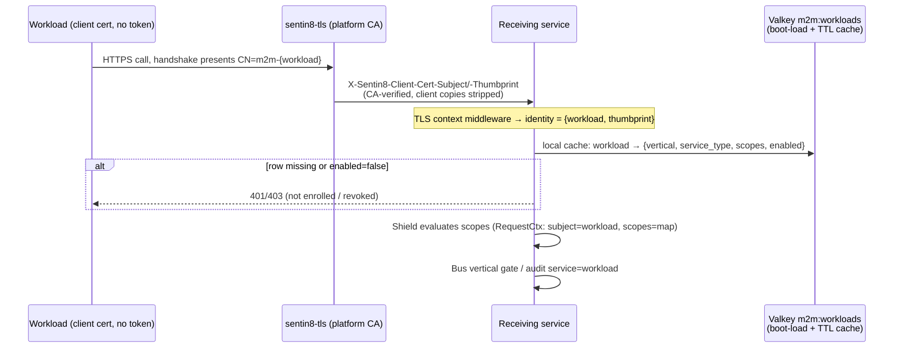

**The authorization record travels as the registry map.** `sentin8-cli
vertical enroll` already provisions `auth.m2m_scope_grants` and publishes
`captain:*` Valkey keys; it additionally publishes a `m2m:workloads` hash -
`{workload} → {vertical, service_type, scopes[], enabled}` - and every
service boot-loads it and TTL-caches it (the platform's mandated pattern:
owner data is seeded on cold start / cache miss, never read on the request
path - §4.14/§6.6). This answers the three consumers the token previously
fed:

| Consumer | Was (token claim) | Now (map field) |
|---|---|---|
| Shield `RequestCtx` (scope-gated rules) | `scope` | `scopes` (roles: none - M2M workloads never had role assignments) |
| Bus VDC-2 event-ownership gate | `vertical` | `vertical` (produce + consume identity checks) |
| Audit `service` stamp / Sys tenant-snapshot | `sub` (opaque hex) / `service_type` | CN directly / `service_type` |

**Revocation** is the map's `enabled` flag: `vertical enroll` (or the admin
surface) flips it, every service's cache observes it within the TTL, and the
workload's calls are refused. This is *more immediate* than the token path
(a minted token lives to expiry regardless) and is bounded by the cache
TTL. Handshake-level certificate revocation (a stolen cert's *validity*)
remains a follow-up (CERTFREE-2) - a pre-existing gap, not a regression.

**Security posture vs the token design (2026-10-07 review):** the move is a
net improvement - per-call proof-of-possession (the token was a pure bearer
at the target; `verify_cert_binding` was a stub) and fleet-wide revocation
where none existed for M2M JWTs. The multi-tenant boundary does not move:
tenancy was never carried by machine identity (WARN-21: the request's env
is authoritative for M2M), and RLS + explicit `env_id` clauses + Shield
remain the tenant gates. Two new risks are ACCEPTED-AND-FILED:

- **The map's write surface is authorization escalation.** Any process
  with Valkey write access can `HSET m2m:workloads` itself any scope set,
  and the 30s TTL propagates it fleet-wide - a primitive the
  signature-verified token design denied (scopes were minted from a DB row
  Auth signed). Countermeasure: Valkey ACLs (CERTFREE-4) - m2m:* writes
  restricted to the operator/enroll writer identity; services hold a
  read-only reader identity.
- **Certificate lifetime bounds the theft window.** The 365-day default
  mint + no expiry check in the load path (a day-366 fleet brick) is
  tightened to a 30-day default with load-path NotAfter verification and
  auto re-mint (CERTFREE-5), alongside CERTFREE-2's CRL.
- Per-instance distinguishability collapses to the workload name (two
  instances share `{workload}.crt`) - accepted; audit identifies
  workloads, never instances.

**Invariants (CERTFREE-1):**

- The certificate is the *only* platform-workload credential: no secret, no
  bearer, no assertion. The `m2m-` CN prefix is minted exclusively by
  Acme's guarded issuance channels (bootstrap enrollment - pinned to the
  declared set by CERTFREE-3; self-issuance `sub == service_name`; the
  enroll operator scope).
- The TLS-injected headers are trustworthy because (a) `sentin8-tls`
  injects them only after CA verification, (b) client-supplied copies are
  stripped before the app sees them, and (c) they exist only on
  TLS-terminated platform hops - the same trust model `X-Sentin8-Env-Id`
  already carries.
- A workload can only ever exercise scopes its map entry allows (Shield
  evaluates from the map; policy rules are unchanged).
- `oauth_clients` and DCR survive for interactive clients (auth-code,
  device flow, BFF apps, dash) and out-of-band tenant clients
  (`client_secret_basic`/`private_key_jwt` per registration) - Auth
  remains the single identity plane for every HUMAN-facing flow; the
  token-free plane covers machine-to-machine platform calls only.
- **Rejected:** keeping the token as "extra" (it was the storm's root
  cause and adds no proof beyond the handshake); services reading
  `auth.m2m_scope_grants` directly (§4.7 - the map is the transport, no
  cross-schema grants); a live Auth resolve API per request (per-request
  dependency, banned by the runtime discipline).

**What is deleted for the platform path:** `/mtls/oauth/token`
`client_credentials` use by platform workloads; the `sentin8-m2m` token
source, DCR helper, credential cache, boot probe, and 401 self-heal
machinery (the crate shrinks to certificate mint-if-missing, renamed for
its real job); `build_with_dcr` background DCR retries in bus-client; every
service's boot-time DCR block; the `cli-producer` / `cli-delegator` /
`bff-delegator` token workloads (the CLI and BFF present certificates);
BFF's env-credential fallback. Delegated tokens keep their `cnf`
cert-binding (unchanged) - BFF presents its certificate and receives a
delegated JWT as today; only the *workload's own* M2M JWT disappears.

## 6. Failure Modes & Recovery

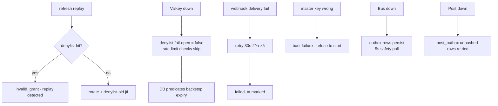

- **JWKS rotation**: insert-new-key overlap (all persisted keys published);
  no scheduled rotation task - old tokens verify until expiry.
- **Session expiry**: enforced by predicates; no sweeper (rows are
  harmless after expiry).
- **DCR storm protection**: anonymous DCR gated by `m2m_scope_grants`
  (service must be enrolled) + cert channel possession proof. Platform
  workloads never DCR and never fetch tokens (§4.3f) - a DB reset can no
  longer strand cached `client_id`s; a missing grant row surfaces as a
  named workload refusal (`workload not enrolled`) from the registry map,
  fixed by enrollment.
- **Token-free M2M failure modes (§4.3f)**: certificate missing at boot →
  Acme mint (bootstrap channel, declared-set-pinned) → retry with backoff;
  map row missing/disabled → 401/403 until enroll/revocation is reverted
  (the map is the authorization record); Valkey down at boot → services
  start with the last cache file / an empty map and refuse unenrolled
  workloads fail-closed (enrolled workloads ride the persisted cache
  copy); map edit → next TTL refresh reflects it.

## 7. Concurrency & Performance Model

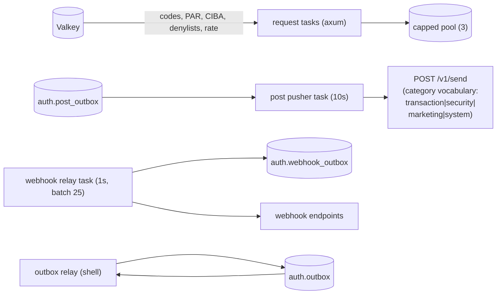

- Sign-in hot path: 2 PG round-trips + 3 Valkey ops (rate, lockout,
  session); JWKS cached 5 min in every consumer SDK.
- Token minting: one signing op (ML-DSA-65); key material cached in
  process.
- Webhook relay batches 25 per tick to bound endpoint fan-out.
- **Post pusher identity is process-lifetime.** The `auth-post`
  `TokenSource` is resolved once and reused across passes (audit-pusher
  pattern, `crates/audit` §6.8): the cached token covers ~10 passes
  before the 60s-before-expiry refresh, and a 401 triggers the m2m
  crate's single-flight self-heal (re-issue + re-DCR, 60s cooldown) -
  never a per-pass `register_or_load_m2m_client` load + credential
  probe + fresh mTLS client. A per-pass rebuild would run two PQ TLS
  handshakes + two token POSTs every 10s whose transient allocations
  ratchet glibc arenas (observed idle RSS growth ~2 MB/min, AGENTS
  target-state rule: no transitional churn paths).

### 7.1 Invalidation triggers on access-grant mutations (policy family)

Identity-cache invalidation (policy runtime's recognized triggers:
`sentin8:sys:identity:updated`, `sentin8:auth:membership:created|deleted`
- sentin8-policy runtime.rs `invalidation_env_id`) rides the SYSTEM-env
`policy` stream because policy consumers (every service's M2M workload)
are registered in the SYSTEM env - that is the transport, not a policy
choice. The shell outbox relay holds exactly one M2M workload
(SYSTEM-env, `sentin8:bus:produce`), and Bus's produce gate
(`env_id does not match the authenticated tenant`) rejects any row whose
`env_id` differs from the token's env: **tenant-env outbox rows can
never reach the `policy` stream**. Therefore every mutation that grants
or revokes access emits, in the SAME transaction as the domain change,
a SYSTEM-env row (`SENTIN8_SYSTEM_ENV_ID`, family `policy`, event
`sentin8:auth:membership:created`/`sentin8:auth:membership:deleted`,
payload `{"env_id": <affected tenant env>, "user_id": <subject>}`) -
env to sweep rides the payload (the tenant-env fan-out row for domain
consumers stays, on the `auth` family). Covered mutations: sign-up
closure provisioning (`auto_add_to_app_groups`, one invalidation per
env touched), admin group member add/remove, and the cross-service
provisioning endpoint `provision_group_member`. Emission is
best-effort: an RLS/failure drop logs and degrades to the RoleResolver
30s TTL. The tenant context on the emitting transaction is switched to
SYSTEM for the invalidation INSERT (`set_config` is transaction-local)
and restored for any subsequent tenant-plane statement - policies on
`auth.outbox` match `env_id = current`, so the row must be written
under the env it carries.

## 8. Invariants, Insecure-Defaults Rejected, Unsafe Rationale

1. **Single identity plane** - no other service mints tokens/JWKS; the
   provisioning API is the only cross-service write path to `auth.*`
   (cross-schema INSERTs retired).
2. **M2M is certificate-bound by default** - a stolen token without the
   key is useless; DCR for `client_credentials` requires the mTLS cert
   channel (no dev fallback).
3. **`scope` is not the decision** - handlers never re-check scopes; step
   5 resolves live identity.
4. **Refresh rotation + jti denylist** - replay within TTL is detectable;
   fail-open only on cache outage (expiry predicates backstop).
5. **No existence oracle** - uniform `invalid_client`; dummy bcrypt on
   unknown accounts.
6. **Tenant-scoped uniqueness** - emails/roles/groups unique per
   `(env_id, …)`; sessions carry `token_id` UNIQUE.
7. **Actor tokens are time-boxed and audited** - TTL clamp ≤ 3600s,
   `auth.actor_events` + jti revocation table.
8. **Keys persisted + encrypted**; wrong/rotated master key refuses boot.
9. No `unsafe` in the service; manual ML-DSA-65 signing wrapped in the
   crypto provider boundary.
10. **No per-pass identity churn.** Long-lived background pushers bind
    their M2M `TokenSource` for the process lifetime; identities are
    re-established by the token-source self-heal on 401, not by
    rebuilding clients every pass (DESIGN §7).
11. **Invalidation rows carry SYSTEM env.** An access-grant mutation's
    invalidation row is written under the SYSTEM tenant context with
    `env_id = SENTIN8_SYSTEM_ENV_ID`; a tenant-env row is silently
    dropped by RLS at emit time (policy `outbox_insert`: `env_id =
    current`) and denied at the Bus produce gate - both fail closed
    (DESIGN §7.1).
12. **Auth reads `sys.app_instances` only through Sentin8:App's owner
    API.** The sign-up closure provisioning needs the env's
    customer-mode (allow_signup) instance ids: the former direct-table
    read violated DBX §6.6a (auth held no grant on `sys.app_instances`
    after the sys.* grant retirement - the read failed RLS-grantless
    and "provisioned NO permission closure" on every customer-env
    sign-up). Target state: `auto_add_to_app_groups` calls Sentin8:App
    `GET /v1/app/instances/customer-mode?env_id=…` (M2M workload
    `auth-sys`, scope `sentin8:app:instances:read`, env-bound) - the
    owner never shares tables (DESIGN §7.1).

## 9. Testing Strategy

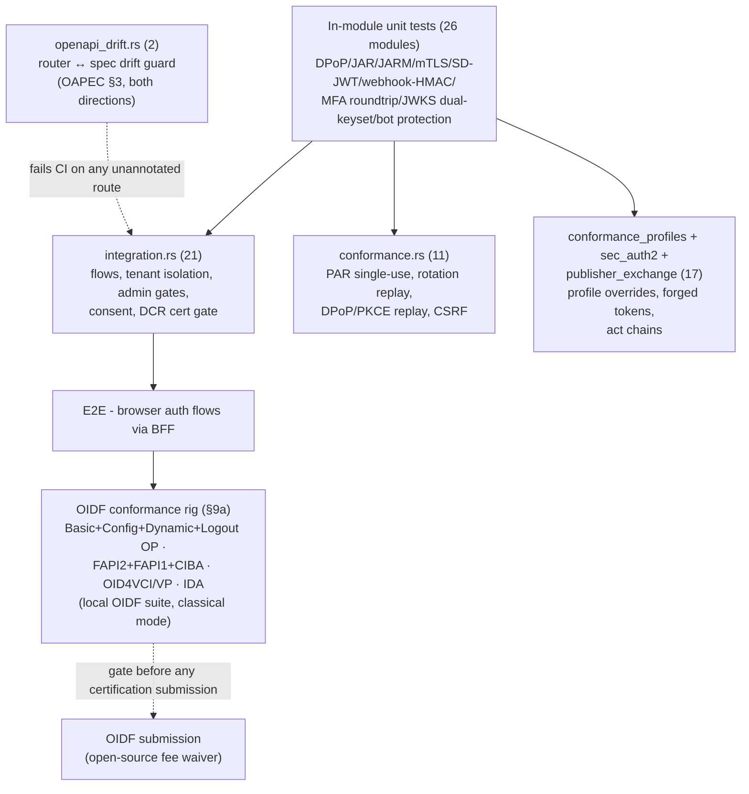

- OpenID certification live flows run against a dedicated local
  conformance rig (§9a) - the OIDF suite's own tests are not part of the
  in-service test binary. The rig is the pre-certification gate: every
  profile in §9a must be green locally before a certification submission
  is prepared.
- Deliberately not covered in-service: real IdP SSO round-trips, PQ TLS
  transport (platform-level).

## 9a. OIDF Certification Program (conformance rig)

Sentin8:Auth is certified through the OpenID Foundation conformance
suite (gitlab.com/openid/conformance-suite). The suite is open source
and free to run; certification fees are waived for this project under
the OIDF open-source project certification policy. The program covers
every profile the platform implements except two deliberate exclusions.

### 9a.1 Certification scope (target state)

| Profile family | Certifiable profiles | Suite posture |
|---|---|---|
| OIDC Core | Basic OP, Config OP, Dynamic OP | code flow + discovery + DCR; the deprecated response types are excluded (below) |
| OIDC Logout | RP-Initiated Logout, Back-Channel Logout | both endpoints implemented; Front-Channel Logout is an exclusion |
| FAPI 2 | Security Profile OP, Message Signing OP | the platform-default `fapi_2` profile |
| FAPI 1 | Advanced OP (final) | `fapi_1_advanced` profile |
| FAPI-CIBA | Poll mode, Ping mode | `bc-authorize` + CIBA grant + ping delivery |
| OID4VCI | Issuer | wallet credential-issuance surface |
| OID4VP | Verifier | wallet presentation surface |
| Identity Assurance (eKYC-IDA) | OP | `claims`/`verified_claims` at authorize |

**Deliberate exclusions (design decisions, never to be reintroduced):**

- **Implicit OP / Hybrid OP** - the implicit and hybrid response types
  (`token`, `id_token`, `id_token token`, `code token`, …) are deprecated
  by OAuth 2.1 and forbidden by FAPI. `response_types_supported` is
  exactly `["code"]` and the authorize handler rejects any other value.
- **Front-Channel Logout** - third-party iframes are a tracking surface
  and silent-failure mode; logout signaling is back-channel only
  (`backchannel_logout_supported: true` is advertised in discovery, no
  `frontchannel_logout_uri` client field, no session iframe).

### 9a.2 Local conformance rig (how the tests run)

The certification pipeline is fully local and reproducible. No OIDF
account or payment is needed until a certification submission is filed.

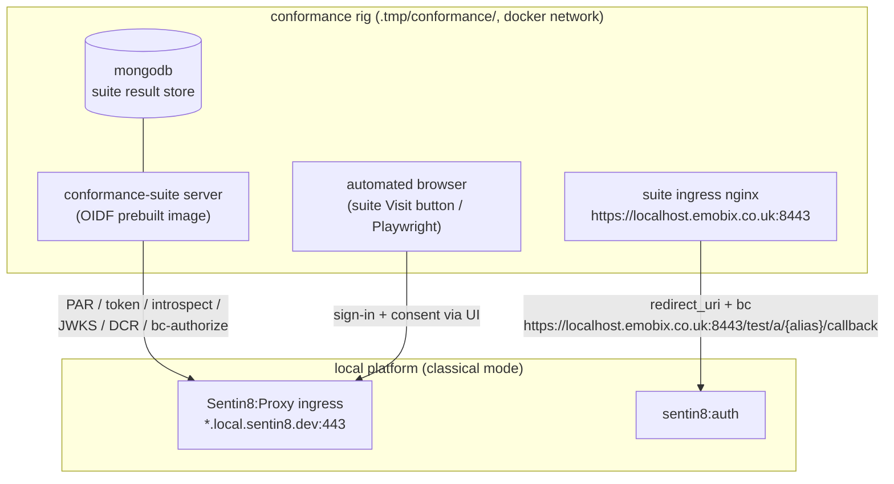

**Rig mechanics:**

1. **Suite stack** - the OIDF `docker-compose-prebuilt.yml` (mongo +
   server + nginx) runs under `.tmp/conformance/` with
   `BASE_URL=https://localhost.emobix.co.uk:8443`, pinned via
   `IMAGE_TAG` for reproducible runs. `localhost.emobix.co.uk` resolves
  to 127.0.0.1 in `/etc/hosts`.
1b. **Suite ingress TLS (no cert warnings - OIDF-CERT-1, §9a.10).**
   The suite's nginx image ships a self-signed `CN=localhost` cert that
   no browser trusts; every front-channel browser test (login →
   callback) and the operator's plan tab died on
   `ERR_CERT_AUTHORITY_INVALID` (11 INTERRUPTED + 1 WAITING/FAILED in
   the 2026-10-21 run). The rig therefore serves the suite ingress
   from a **platform-CA server leaf**: `--ensure-infra-tls` mints
   `conformance-suite-server.crt/.key` (CN `conformance-suite`, SAN
   `localhost.emobix.co.uk` - the Acme root CA is already in the OS
   trust store), `make conformance-up` copies the pair into the
   compose build context, and the compose nginx service bind-mounts
   them read-only over the image's hardcoded
   `/etc/ssl/certs/nginx-selfsigned.crt` + `/etc/ssl/private/
   nginx-selfsigned.key` paths (no image rebuild; the image's own
   nginx.conf keeps working). The suite stays reachable at
   `https://localhost.emobix.co.uk:8443` with a fully trusted chain.
2. **Certification environment** - a dedicated org + env (`cert`) whose
   security profile is `standard` (for OIDC Core/Config/Dynamic runs)
   or `fapi_2` / `fapi_1_advanced` (FAPI runs). One test user with a
   known password, seeded through the BFF API exactly like an E2E test
   (no direct SQL - AGENTS E2E rule applies to the rig too).
3. **Suite-visible posture (classical mode)** - the rig environment
   sets `SENTIN8_TLS_PQ_MODE=classical` (TLS 1.2/1.3 + RSA/ECDSA certs,
   JWT signing RS256) because the suite's Java client cannot speak the
   platform's post-quantum-only TLS or verify ML-DSA-65 JOSE. The
   production posture (exclusive PQ) is unchanged; classical mode is the
   suite-compatible lens over the same protocol logic, and the
   platform's emergency-rollback mode is exactly this mode.
4. **Conformance clients** - registered through the DCR endpoint (for
   Dynamic OP runs) or admin API: a `client_secret_basic` client, a
   `client_secret_post` client, a `private_key_jwt` client, a
   `tls_client_auth` client, and a public PKCE client, each with the
   suite callback `https://localhost.emobix.co.uk:8443/test/a/{alias}/callback`
   in `redirect_uris` and the CIBA ping callback in
   `backchannel_uri`/ping fields where relevant.
5. **Browser automation** - the suite's browser-interaction tests
   (sign-in + consent at the hosted UI) are driven via the suite's
   `Visit` flow with a scripted test user; the Flutter auth-ui E2E
   driver may be reused. No captcha or bot-protection challenge is
   present for the cert env (bot protection stays on for real tenants).
6. **Result capture** - each run is exported from the suite
   (`log-detail.html` / JSON) into `.tmp/conformance/results/`, and the
   top-level `make conformance` target boots the suite, seeds, and
   prints a per-profile pass/fail matrix.

### 9a.3 Profile-by-profile implementation state

| Capability | Status | Notes |
|---|---|---|
| Discovery (`/.well-known/openid-configuration`) | implemented | §4 surface; required-when-supported honesty fields in §9a.4 |
| Basic OP (code + PKCE S256, ID token with `nonce`/`auth_time`/`at_hash`/`c_hash`/`s_hash`) | implemented | `c_hash` binds the ID token to the exchanged code; `s_hash` binds it to `state` when present |
| OIDC scope-based claims (`email`/`profile`/`phone`/`address`) | implemented | ID token + userinfo mint the claim family gated on the consented scope: `email`→`email`/`email_verified`, `profile`→name family, `phone`→`phone_number`/`phone_number_verified`, `address`→the OIDC address JSON object; discovery advertises all four scopes and their claims (§9a.4) |
| Config OP (discovery completeness) | implemented | fields in §9a.4 |
| Dynamic OP (DCR + management + WebFinger) | implemented | WebFinger at `/.well-known/webfinger` (`webfinger.rs`) |
| RP-Initiated Logout | implemented | `state` echoed on the registered `post_logout_redirect_uri` redirect |
| Back-Channel Logout | implemented | logout tokens carry `events`/`sid`; discovery advertises support |
| `prompt=none/login/consent` + `max_age` re-auth | implemented | silent issuance or `error=login_required` back to the redirect_uri; `max_age` gates session freshness |
| FAPI 2 Security Profile (PAR + DPoP + JARM + `iss` + rotation) | implemented | platform default |
| FAPI 2 Message Signing | implemented | HTTP message signatures + signed introspection (RFC 9701) |
| FAPI 1 Advanced (PAR + JAR + mTLS + JARM + `iss`) | implemented | `s_hash` on `state`; `resource` parameter rejected under the `fapi_1_advanced` profile |
| FAPI-CIBA poll mode | implemented | `bc-authorize` + CIBA grant + discovery block |
| FAPI-CIBA ping mode | implemented | notification POST to the registered `backchannel_client_notification_endpoint`, `client_notification_token` as bearer |
| OID4VCI issuer | implemented | standard endpoint shapes in §9a.7 (credential-issuer metadata, `/credential`, offer URI, deferred, notification) over the existing SD-JWT/KB-JWT/status-list core |
| OID4VP verifier | implemented | standard `/.well-known/openid-credential-verifier` metadata + `presentation_definition` handling at the wallet endpoint |
| eKYC-IDA (claims / verified_claims) | implemented | `claims` request parameter (§5.5, narrowing selection) + `verified_claims` in ID token/userinfo from the credential store's assurance data |
| JAR `request_uri` | implemented | the AS fetches the request-object JWT from the client-supplied URI (https scheme only), same verification path as the inline `request` parameter |
| CIBA signed request objects | implemented | `request` JWT (or `request_uri` fetch) at `bc-authorize`, verified against the client's registered keys (CIBA §7.1) |

### 9a.4 Discovery honesty fields

The discovery document carries the following required-when-supported /
recommended fields (advertised only when actually supported):

- **The four OIDC claim scopes are advertised and served**: `scopes_supported`
  is `openid profile email phone address offline_access` - every scope
  advertised is mintable end-to-end (the §9a.10 no-skip rule). The `phone`
  scope gates `phone_number`/`phone_number_verified` at the ID-token and
  userinfo mint; the `address` scope gates the OIDC `address` JSON object
  (built from the users table's postal columns). `claims_supported` lists
  the full claim set: `sub`, `iss`, `aud`, `exp`, `iat`, `auth_time`,
  `nonce`, `at_hash`, `c_hash`, `name`, `given_name`, `family_name`,
  `email`, `email_verified`, `phone_number`, `phone_number_verified`,
  `address`, `verified_claims`.

- `token_endpoint_auth_signing_alg_values_supported` (required when
  `private_key_jwt` is advertised)
- `claims_parameter_supported: true` (completed with the claims parameter)
- `claims_supported` (static list of the claims the ID token / userinfo
  can carry)
- `backchannel_logout_supported: true` + `backchannel_logout_session_supported`
- `revocation_endpoint_auth_methods_supported`,
  `introspection_endpoint_auth_methods_supported`
- CIBA: `backchannel_authentication_endpoint`,
  `backchannel_token_delivery_modes_supported: ["poll","ping"]`,
  `backchannel_authentication_request_signing_alg_values_supported`,
  plus `urn:openid:params:grant-type:ciba` in `grant_types_supported`
- OAuth 2.1 posture: `code_challenge_methods_supported` already `S256`
  only; PKCE stays mandatory for public clients.

### 9a.5 Certification runbook (per profile)

The rig collateral lives in **`sentin8-auth-oidf/conformance/`** — the
conformance automation repo owns its own provisioning surface (compose file,
seed script, server Dockerfile, runbook) — while the group `sentin8/`
Makefile exposes `make conformance-up / conformance-down / conformance-purge /
conformance-seed`. The fleet side of a rig run is `make start-conformance`:
it starts the platform in the rig posture (classical TLS, FAPI cipher
profile, RFC 8705 self-signed client-cert surface) WITHOUT mutating
`../.env` — `make start` remains the production-posture start. The suite's
Java runtime must trust the platform CA: import
`.run/secrets/acme-ca/root-ca.crt` into the server container's truststore
(runbook §1).

1. Start the platform in the rig posture (`make start-conformance` —
   the classical profile ships from the target itself, not the root
   `.env`) and `make conformance-up`.
2. `make conformance-seed` - provisions the certification tenant
   (org `conformance-local`, env `cert`, test user, suite clients via
   DCR with the suite callback) through the platform API only
   (no direct SQL; inputs land in `.tmp/conformance/cert-user.env`).
3. Create the test plan in the suite UI: "OpenID Connect Core: Basic OP"
   (then Config, Dynamic; Logout: RP-Initiated + Back-Channel; FAPI 2:
   Security Profile then Message Signing; FAPI 1: Advanced; CIBA: Poll
   then Ping; OID4VCI issuer; OID4VP verifier; IDA) with alias
   `sentin8-local` and the cert env's discovery URL.
4. Run each test; the suite's browser automation completes sign-in via
   the HTML login page (§9a.8) with the seeded test user.
5. All tests must be PASSED / WARNING / REVIEW (no FAILED, no
   INTERRUPTED) before the profile is considered green locally - and
   **no test may be SKIPPED** (§9a.10): a suite skip means discovery
   advertised the capability away, which is a coverage hole, not a
   pass.
6. Export logs to `.tmp/conformance/results/`, then `make conformance-down`.

### 9a.10 No-skip rule (conformance coverage)

**A skipped conformance test is a failed conformance test.** The suite
SKIPPED a test exactly when the discovery document declined to advertise
a capability it tests (e.g. `scopes_supported` without `address`/
`phone` → the scope tests self-skip). Advertising a capability away is
hiding a coverage hole behind discovery honesty - the platform's rule is
the inverse: **implement the capability, advertise it, let the suite test
it**. Concretely: every scope in `scopes_supported` must be mintable
end-to-end (authorize → token → ID-token/userinfo claims), every
`claims_supported` entry must be producible by at least one scope, and a
new suite skip is triaged as a defect with the same priority as a FAILED
result. The rig's seed (§9a.5 step 2) must therefore also provision the
data the advertised claims need (the cert user carries a phone number and
a postal address) so scope tests that assert claim presence can pass,
not just run.

### 9a.6 Sequence - a suite browser interaction (authorize round-trip)

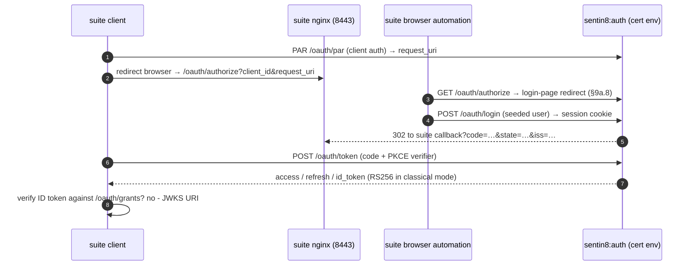

### 9a.7 Wire-level certification surfaces

**JAR `request_uri` (RFC 9101 §5.2.1).** When the authorize request
carries `request_uri` (and it is NOT a PAR urn), the AS fetches the
request-object JWT from the URI — `https` scheme only, response body
size-capped, 10s timeout — then runs the same verification path as the
inline `request` parameter: unverified decode, `validate_jar_claims`,
`exp` freshness (±10 min), signature against the client's registered
`jwks`/`jwks_uri`. The fetched JWT overlays inline params identically.
This is what the FAPI 1 Advanced suite exercises (it pushes request
objects by URI).

**Unsigned request objects (`alg: none`, RFC 9101 §5).** The value-form
(inline `request` parameter) request object MAY be unsigned: the
integrity story is the TLS transport plus the AS's own client
authentication binding — no registered key is needed. The shared
client-JWT verifier short-circuits on `alg: none` (everything else
requires a verified signature), discovery advertises `none` in
`request_object_signing_alg_values_supported` (§9a.10 honesty:
advertised = served), and the suite's
`unsigned-request-object`-family tests then RUN instead of skip.
Fetched-by-URI request objects keep the https-only + signed rules
(an attacker-controlled URI cannot carry `none`).

**CIBA signed request objects (CIBA §7.1).** `bc-authorize` accepts a
`request` JWT (or `request_uri` fetch, same mechanics as above) signed
by the client's registered keys. Its claims carry the CIBA parameters
(`scope`, `client_notification_token`, `request_mode`, `login_hint`,
`binding_message`, `requested_expiry`, `exp`). On success the JWT's
parameters REPLACE the form parameters (signed wins); verification is
the same verifier as JAR's. Unsigned (form) parameters remain supported
for poll-mode and platform-internal callers.

**OID4VCI issuer (SD-JWT VC profile).** Standard endpoint shapes over
the existing SD-JWT/KB-JWT/Status-List core, all issuer-hosted on auth:

- `/.well-known/openid-credential-issuer` — metadata:
  `credential_issuer`, `credential_configurations_supported` (one entry
  per credential type auth mints), `credential_endpoint`,
  `deferred_credential_endpoint`, `notification_endpoint`,
  `credential_issuer_session` metadata as needed by the flow variant.
- `POST /oauth/credential` — single-credential issuance request:
  `credential_configuration_id`, optional `proof` (a `jwt` proof holding
  the wallet's attestation key: `iss=client_id`, `aud=issuer`, `exp`,
  nonce-bound); authorization rides the existing grant families
  (authorization_code with the credential scope via the standard
  authorize flow, or pre-authorized_code for QR-initiated flows).
  Response: the signed SD-JWT credential (format `sd-jwt`), or
  `transaction_id` + HTTP 202 for deferred issuance.
- `POST /oauth/deferred_credential` — poll a `transaction_id` →
  credential once minted.
- `POST /oauth/notifications` — the wallet's events (credential
  received/failed) are recorded against the credential record.
- The internal offer record (credentials table) is the same store; the
  standard `/oauth/credentials` endpoints remain as the platform-native
  alias surface.

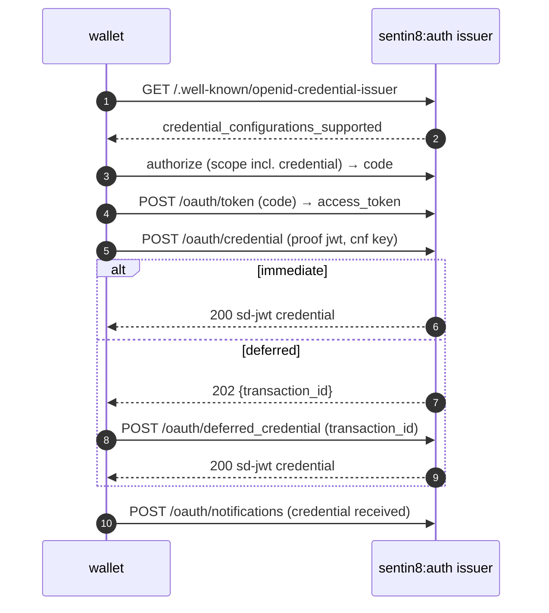

**OID4VP verifier.** `/.well-known/openid-credential-verifier` publishes
the verifier metadata (redirect_uris, presentation definitions
supported, client_id schemes). The existing wallet sign-in endpoint
accepts a standard `presentation_definition` (or by reference:
`presentation_definition_uri`) alongside the existing SD-JWT VP
handling; the request object binding (`client_id`,
`client_id_uri_scheme`) follows OID4VP §5.

**eKYC-IDA `verified_claims` (OIDC eKYC-IDA §5).** The `claims` request
parameter (`id_token`/`userinfo` sub-objects, `essential` flags) is
accepted at authorize and applied at the ID-token/userinfo mint as a
claim SELECTION (never widening — a claim the consented scope did not
grant stays absent). When the request selects `verified_claims` (or the
user holds an active wallet credential of the matching type), the
ID token/userinfo carries `verified_claims` built from the credentials
store: `verification` (trust framework, evidence, time) + `claims`
(the verified subset), per the eKYC-IDA claim shape. `claims_supported`
lists `verified_claims`; discovery advertises
`claims_parameter_supported: true`.

### 9a.8 Server-rendered HTML login page (automated-client surface)

The hosted UI at `/sign-in` is the full **Flutter auth-ui** (canvas
SPA) — the product surface for humans. Canvas apps expose no DOM input
elements, so DOM-driven automation (the OIDF conformance suite's
browser runner, Selenium-class RPs, CI clients) cannot complete the
interactive login. Auth therefore serves a **server-rendered HTML
login page** as a first-class surface for automated clients — the
human flow stays on the Flutter UI.

**Endpoints (both public, form-encoded; DESIGN §4 table updated):**

- `GET /oauth/login` — the HTML page. The authorize handler's sign-in
  redirect targets this path for OAuth flows (the `/sign-in` SPA route
  remains for human navigation and app-initiated sign-in). The page
  carries the OAuth context in a signed hidden field (HMAC over the
  authorize params, TTL 10 min — the form cannot be used to steer a
  different authorization request) plus visible fields with stable
  element ids the suite's browser commands drive:
  `input#username`, `input#password`, `input#submit` (`type=submit`).
- `POST /oauth/login` — the form handler: verifies the context HMAC,
  authenticates via the same password path as `POST /v1/sign-in`
  (shared credential + lockout + rate-limit logic), creates the
  session cookie, then re-dispatches the preserved authorize request
  through the authorize-continue code path. Wrong credentials
  re-render the page with `#error_message` visible (the suite's
  negative tests read it); a valid login issues the code and 302s to
  the client's `redirect_uri`.

**Why a form POST, not fetch/XHR:** the page is deliberately
JavaScript-free — a canvas-free, JS-free form works under every
headless driver. The CSRF posture matches `POST /v1/sign-in` (the
login form IS the cross-site concern; the OAuth context HMAC binds the
form to one authorize request, and the session cookie is set with the
platform's same-site/Csrf cookie attributes).

**First-party consent bypass keeps the flow one-page:** the platform's
existing `consent_required=false` client flag (§4.16) makes the login
page the ONLY interactive step — after authentication the code is
issued directly. Conformance clients register with the flag set, so
the suite's browser automation completes in one form submission.

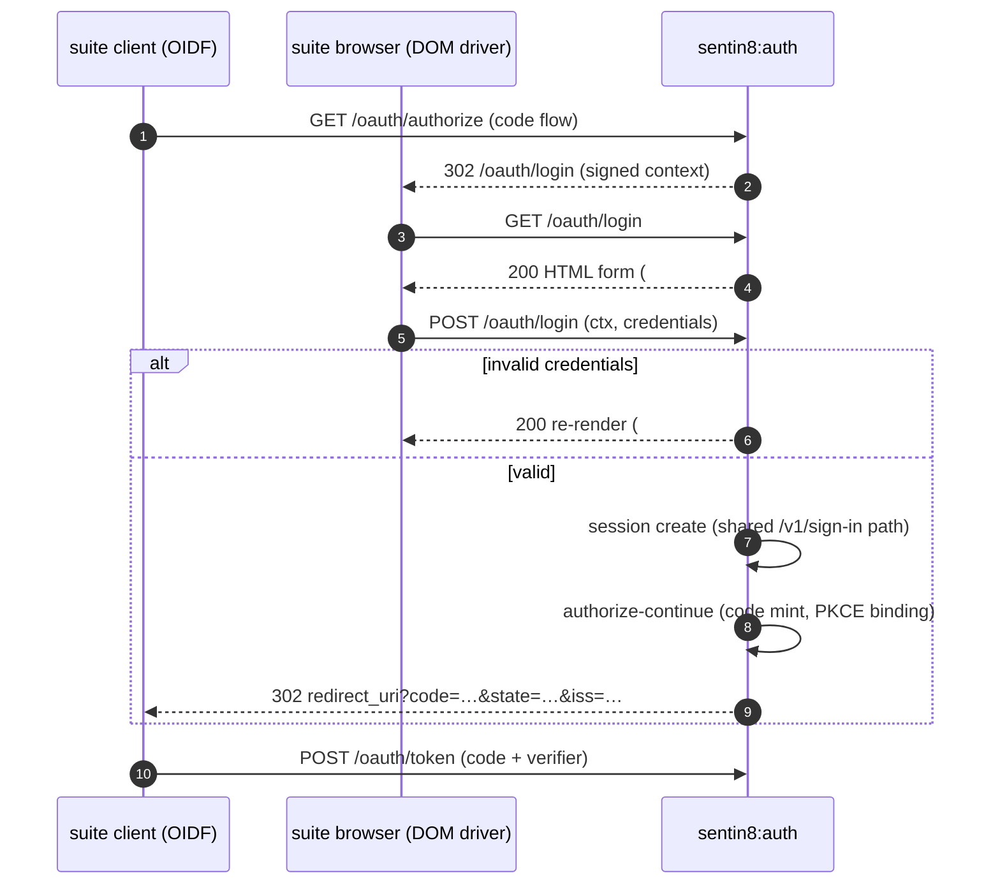

### 9a.9 Per-tenant JWT signing algorithm (security-profile plane)

`SENTIN8_TLS_PQ_MODE` is a **process-level** switch that selects the JWT
signing algorithm family (`MLDSA65` vs `RS256`) for the whole service.
That is the right shape for the **TLS transport** half it also controls
(the ClientHello's key exchange completes before the SNI hostname - and
therefore the tenant - is known, so per-tenant TLS groups are
physically impossible on one listening socket). But the **JWT signing**
half is decided per-request, after tenant resolution - and a fleet-wide
classical flip just to serve one suite-compatible tenant (the
certification rig) demotes every other tenant's token security.

The target state moves JWT signing onto the security-profile plane:

- `security_profiles` gains a `signing_alg` column
  (`MLDSA65` | `RS256`, default `MLDSA65`), resolved
  platform → org → env exactly like the profile flags
  (`resolve_security_profile`).
- `SigningKeys` loads **both** algorithm key sets at boot (it already
  verifies both for rotation overlap; both are persisted). The active
  key per family is selected at **sign time**: `sign_value_alg(claims,
  alg)` picks the ML-DSA or RSA active key from the requested family.
  Absent key material for a family fails loudly (it is generated on
  boot, so absence means the store was tampered with).
- Every mint site that resolves a tenant context (ID token, access
  token, refresh token, JARM, logout token, SD-JWT credential) signs
  with the caller's env-resolved `signing_alg`. `SENTIN8_TLS_PQ_MODE`
  remains the **process default** for contexts with no profile row
  (the platform-plane row seeds `MLDSA65`, so the platform keeps PQ
  signatures everywhere by default).
- Discovery/JWKS honesty: the JWKS endpoint publishes **all** persisted
  keys (both families - verifiers need the overlap set), and discovery
  advertises the **caller's env-resolved** `id_token_signing_alg_values_supported`
  (the resolved family), so a suite tenant advertises `RS256` while the
  platform plane advertises `MLDSA65`.
- **Acme cert families are out of scope here**: leaf certs are minted
  per-hostname by Acme; the family follows the TLS transport mode
  (process-level) - the per-tenant setting governs JWTs only.

```mermaid
sequenceDiagram
    autonumber
    participant C as client (cert env)
    participant OP as sentin8:auth
    participant P as security_profiles (env row)
    OP->>P: resolve_security_profile(env)
    P-->>OP: signing_alg = RS256 (cert env) / MLDSA65 (default)
    OP->>OP: sign_value_alg(claims, alg) - active key of that family
    OP-->>C: id_token (alg per the env's row; JWKS serves both families)
    C->>C: verify via JWKS (kid-routed, family-agnostic)
```

**Why not per-tenant keys?** One key set per family (platform-global)
keeps rotation (`jwks rotation timer`) and revocation semantics
unchanged; per-tenant keys multiply rotation surface ×N with no
security gain at the JWT layer (the tenant boundary is the claim set,
not the key). Rejected as future-work if a tenant ever demands BYOK.

### 9a.11 Warning-zero posture (suite WARNING classes → root fixes)

The no-skip rule (§9a.10) makes FAILED/INTERRUPTED/SKIPPED blocking;
the 2026-10-21 Basic-OP run additionally surfaced six WARNING classes.
An owner decision promotes the target to **WARNING-zero**: every suite
WARNING is a real (if spec-permissive) gap on our side and gets a root
fix rather than an explanatory note. The classes, their owners, and the
target shapes:

| # | Suite warning | Root cause | Target state |
|---|---|---|---|
| 1 | "JWK set contains unsupported key type (kty `MLWE`)" (every instance) | JWKS publishes BOTH signing families; the suite's Java JOSE stack cannot parse ML-DSA | **Tenant-plane filtered JWKS** (below) |
| 2 | userinfo lacks the `profile` scope's standard claims (`name`, `nickname`, `preferred_username`, `middle_name`, `website`, `picture`, `gender`, `birthdate`, `zoneinfo`, `locale`, `updated_at`, `profile`) | userinfo mints only given/family name | `users.oidc_profile` JSONB + full family mint (below) |
| 3 | "Unexpectedly found email in id_token" (scope tests) | ID token carries scope-consented claims even when the claims request selected none | **§5.5-conservative ID token**: user claims ride the ID token only when the claims request selects them; userinfo remains the scope-gated delivery surface |
| 4 | "acr requested but not returned" | `acr_values` unaccepted at authorize | `acr_values` accepted → code record → `acr` claim in the ID token |
| 5 | "resource endpoint returned a different http status than expected" (codereuse-30s) | code reuse does not revoke the grant; userinfo serves the old access token 200 | **RFC 6749 §4.1.2 reuse revocation**: a replayed (burned) code revokes its grant at the second exchange; userinfo/introspect enforce token-denylist AND grant-revocation |
| 6 | "name not found in userinfo" (claims-essential) | #2 | covered by #2 |
| 7 | "Unknown properties were found in the OAuth Authorization Server metadata" (FAPI2 discovery-end-point-verification) — offender `software_statement_supported` | discovery advertises platform-extension metadata the FAPI profiles' RFC 8414 allow-list does not know | **Profile-honest discovery**: platform-extension members (`software_statement_supported`, `grant_management_endpoint`) ride discovery only when the caller's env profile is NOT a FAPI profile (FAPI profiles advertise the RFC-standard surface only) |
| 8 | "userinfo response includes claims with names that are not known" (FAPI2 claims-parameter) — offenders `roles`/`groups`/`scopes`/`client_id` | userinfo projections carry the platform-plane identity members on every host | **OIDCC-5.1 standard-claims surface under FAPI**: the platform-plane projection rides only on non-FAPI hosts (Shield substrate resolver + BFF session enrichment are platform-plane, unaffected) |
| 9 | ServerAllowedExpiredAuthorizationCode (FAPI2 expired-auth-code FAILED) | the Valkey TTL (600s) was the only code expiry; FAPI 2.0 mandates a SHORT-LIVED code | **60s code-lifetime gate (DESIGN §9a.11)**: every code record carries its issue-time `iat`; the exchange wall-clock-checks it (60s) and 400s `invalid_grant` `authorization code expired` |

**Tenant-plane filtered JWKS (detail).** §9a.9 resolves one signing
family per tenant; the JWKS endpoint applies the same resolution: it
publishes only the persisted keys of **the caller's env-resolved
family** (platform fallback when no row resolves). A rig tenant
(`signing_alg = RS256`) sees RSA keys only - the suite parses everything
it fetches - while an ML-DSA tenant sees ML-DSA keys only. Rotation
overlap stays within the family (insert-overlap, §3.13). Cross-tenant
token verification is unaffected: tokens name their kid, and a verifier
validates a token minted in another tenant only through that tenant's
own issuer surface.

**The `oidc_profile` column (detail).** The `users` table gains
`oidc_profile JSONB NOT NULL DEFAULT '{}'` holding the scope-consented
profile-family members the platform mints verbatim: `nickname`,
`preferred_username`, `middle_name`, `profile`, `picture`, `website`,
`gender`, `birthdate`, `zoneinfo`, `locale` (the admin write surface
accepts them). `name` and `updated_at` are DERIVED at mint time: `name`
falls back through `oidc_profile.name → first_name + ' ' + last_name`,
`updated_at` is the row's `updated_at`. The userinfo + ID-token mints
emit every populated member gated on the `profile` scope; empty members
are omitted (`skip_serializing_if`), never `null`. This is a greenfield
schema change (AGENTS no-migration rule): `sql/init.sql` changes and the
tenant re-inits - the certification tenant + suite clients re-seed after
(`make conformance-seed`), suite plans in the mongo volume survive.

**acv/`acr_values` flow.** authorize accepts `acr_values` (space-
delimited, OIDC Core §3.1.2.1) into a dedicated `acr` field on
`AuthorizeQuery`/`AuthorizeContinueRequest`, rides the code record, and
the ID-token mint echoes the FIRST requested value as the `acr` claim
(the platform issues a single effective assurance level per session;
§9a.11 note: future MFA binding graduates this to real AAL levels).

**Reuse revocation flow.** The first code exchange deletes the code as
today but RECORDS the burned code's grant id (Valkey
`auth:burnedcode:{code}` = `"<grant_id>|<env_id>"`, TTL = code TTL -
the pair lets the replay path run the revocation under the RIGHT RLS
tenant context before any code-record lookup). The replay check runs
BEFORE the code fetch (the burned mark is the only trace a replay
leaves - the code record itself was deleted at first use): a second
exchange of the same code treats the replay as a token-compromise
signal, cascades the grant revocation in a fresh transaction
(`revoke_by_id`: status flip + `auth:grant:revoked:{id}` denylist +
`grant.revoked` event), answers 400 `invalid_grant`, and the burned
mark clears so a THIRD replay cannot re-revoke (idempotency). `userinfo` extends `verify_access_token_claims` with
token-jti denylist + grant-revocation checks (the same predicate
introspection already applies), so the suite's post-reuse resource fetch
gets the expected 401.

**§5.5 selection never drops at the hosted-UI hop.** The UI redirect
forwards the authorize request's `claims` parameter (URL-encoded JSON)
alongside `nonce`/`resource`/`response_mode`/`acr_values`; the
`authorize/continue` request accepts the selection as a JSON object OR
as the object-encoded string the forwarded parameter produces
(`deserialize_claims_flex`) - the code record always ends with the
parsed object, so §5.5-essential checks and the access-token
`userinfo_claims` stamp survive any browser hops in between.

**JAR redirect_uri binding (OIDC Core §6.4.1).** When a request object
carries a `redirect_uri`, the outer authorize request's `redirect_uri`
MUST match it exactly (absent outer is fine - the object's value
wins); a mismatch is a parameter-forgery mix and rejects inline
`invalid_request` BEFORE the hosted-UI hop. The previous accept-and-
override behavior completed a flow with a forged outer parameter and
let the user agent deliver a valid callback after the RP had already
concluded (the suite's redirect-uri-error-page module chokes on the
late callback arriving post-FINISH).

**Authorization-code lifetime gate (FAPI2-SP).** Every code record
(authorize-continue, silent issuance, hosted-UI login submit) stamps
its issue time (`iat`); `handle_code_exchange` wall-clock-checks the
record against a 60-second lifetime BEFORE any validation side
effects (the code is still deleted first - the exchange is one-shot
either way). The Valkey TTL (`set_ex ... 600`) remains the upper
storage bound; the RFC 6749 code-lifetime posture is the wall-clock
gate: an exchange of a record older than 60s answers 400
`invalid_grant` `authorization code expired` (the suite sleeps 62s
and requires the rejection; the Basic-OP suite's rapid exchanges are
unaffected). A missing/unparseable `iat` fails closed.

**Profile-honest discovery (FAPI2 metadata allow-list).** The suite's
OAuth 2.0 Authorization Server Metadata check (`RFC8414-2`) warns on
members outside its RFC-standard set. The platform-extension members
are conditional:
- `grant_management_endpoint` (FAPI 2.0 Grant Management) rides ONLY
  when the caller's env profile IS a FAPI profile (the capability is
  a FAPI-family surface).
- `software_statement_supported` rides only on non-FAPI hosts (the
  DCR software-statement acceptance is a platform capability the FAPI
  final-suite allow-list does not admit).
The RFC-standard members (endpoints, response/grant types,
`claims_parameter_supported`, `dpop_signing_alg_values_supported`, …)
stay unconditional - they are understood by every checker.

**Userinfo = the OIDC standard-claims surface under FAPI (OIDCC-5.1).**
userinfo is the OIDC standard-claims document on FAPI hosts: the
platform-plane projection (`roles`/`groups`/`scopes`/`client_id`/
`token_tp`) rides ONLY when the caller's env profile is NOT a FAPI
profile - the Shield substrate live-identity resolver and the BFF
session enrichment run exclusively on non-FAPI platform hosts and
keep the projection. On a FAPI host the response carries the OIDC
Core §5.1 standard members only (`sub` + the scope/selection-gated
profile/email/phone/address families), which the suite's standard-
claims validator accepts without warnings.

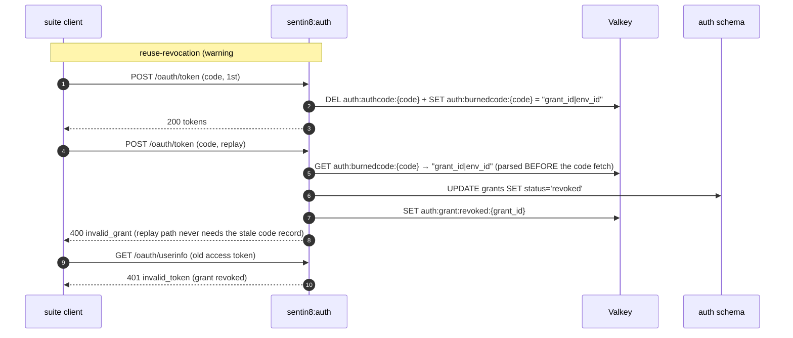

**Resource endpoint accepts the DPoP scheme (RFC 9449 §7.1).** The
token endpoint advertises `token_type: DPoP` for cnf-bound tokens
(warning-table row: CheckTokenTypeIsDpop), and per RFC 9449 §7.1 the
client then presents the access token with the `DPoP` **authorization
scheme** on subsequent resource calls - the suite's resource call
(`EnsureHttpStatusCodeIs200or201`) does exactly that. `userinfo`'s
bearer extraction accepts BOTH schemes case-insensitively
(`Bearer` per RFC 6750 §2.1, `DPoP` per RFC 9449 §7.1) - the token is
verified identically (signature, `cnf.jkt` vs the DPoP proof's key
thumbprint, expiry, grant/deny state); the scheme only names the
transport convention, never the security decision.

**PAR form-parameter contract (RFC 9126 §2).** `request_uri` is the
PAR *response* payload, never a request parameter: a push carrying it
as a form param is malformed and the PAR endpoint rejects it inline
`invalid_request` BEFORE client authentication (the suite's
"authorization request containing request_uri form param" negative
expects the rejection).

**PKCE violations are grant failures (RFC 7636 §4.6).** The PKCE
contract binds the ISSUED GRANT - a missing `code_verifier` or a
mismatched S256 proof at the exchange invalidates THAT grant, so the
token endpoint answers `invalid_grant` (not `invalid_request`, which
names a malformed REQUEST construct). The suite's
`ensure-pkce-code-verifier-required` requires the grant-shape error.

### 9a.12 mTLS client authentication + sender constraint (FAPI2-SP mtls cell)

The FAPI2-SP suite runs four variant cells: `sender_constrain`
(mtls|dpop) × `client_auth_type` (mtls|private_key_jwt). The dpop
cell (private_key_jwt client auth + DPoP sender constraint) is the
one fully green today (§9a.11 addendum); the mtls cells make the
CLIENT CERTIFICATE both the client authentication and, in the mTLS
sender-constrain cell, the token binding. RFC 8705 §2-§3 govern
both surfaces.

**Server-side acceptance of suite-generated client certs
(self-signed, RFC 8705 §2.4).** In the rig the suite generates a
self-signed client certificate per mtls variant and registers it via
DCR (`token_endpoint_auth_method: self_signed_tls_client_auth`) or
carries its PEM in the STATIC plan config. The TLS layer (sentin8-tls
acceptor) gains a listener posture that REQUESTS a client
certificate and accepts the presented cert at the HANDSHAKE without
CA verification (`allow_self_signed` posture, for the cert-tenant
rig surface) - the `X-Sentin8-Client-Cert-Thumbprint` (= `x5t#S256`)
injection covers the UNVERIFIED cert too. The SECURITY decision
never moves to the TLS layer: auth compares the presented thumbprint
against the registration row's
`self_signed_tls_client_auth_thumbprint` (and `subject_dn` for
CA-issued `tls_client_auth`) - an unregistered thumbprint
authenticates NOTHING (cert presence never implies trust; RFC 8705
§2.4 "the AS MUST verify that the certificate is bound to the
client").

**Client authentication methods (authenticate_client).** The shared
client authenticator accepts the mTLS methods when the registration
row carries the matching identity field: `self_signed_tls_client_auth`
→ thumbprint equality with the presented identity; `tls_client_auth`
→ presented subject-DN equality. Both ride the SAME header source
(`extract_mtls_identity`), work identically at `/oauth/token`,
`/oauth/par`, and `/oauth/revoke`, and pair with every
sender-constrain posture.

**Sender-constrained tokens (mtls cell) - `cnf.x5t#S256`.** When the
exchange (or refresh) rides a VERIFIED client-certificate identity,
the minted access token carries `cnf: {x5t#S256: <thumbprint>}`
(`build_cnf_claim`, mtls.rs) INSTEAD of the DPoP `jkt` (a token
carries exactly one confirmation member); `token_type` is `Bearer`
(RFC 8705 §3 - mTLS-bound tokens ride the plain bearer scheme; the
CERT is the sender). The userinfo RS then REQUIRES the request to
present the SAME certificate: a missing/mismatched thumbprint is 401
`invalid_token` - the suite's `ensure-holder-of-key-required` and
mtls resource calls depend on this. Refresh tokens rotate within the
same binding (the refresh call re-presents the cert).

**Suite ingress path.** The suite's mTLS calls terminate at the
Sentin8:Proxy (the single ingress); the proxy forwards the presented
leaf cert as `X-Sentin8-Client-Cert` (PROXY-4). auth resolves the
identity from the forwarded cert DIRECTLY - it computes the RFC 8705
thumbprint itself from the base64 DER and compares it against the
registration row (no dependence on a thumbprint header the proxy
does not produce). `mtls_endpoint_aliases` (token/revocation
aliases) stays advertised only under `require_mtls` (per-profile
posture, §9a.3); the FAPI2-SP mtls-cell variants exercise the
ALIASES (the suite follows `mtls_endpoint_aliases.token_endpoint`),
so the cert-tenant profile seed sets `require_mtls: true` for those
cells.

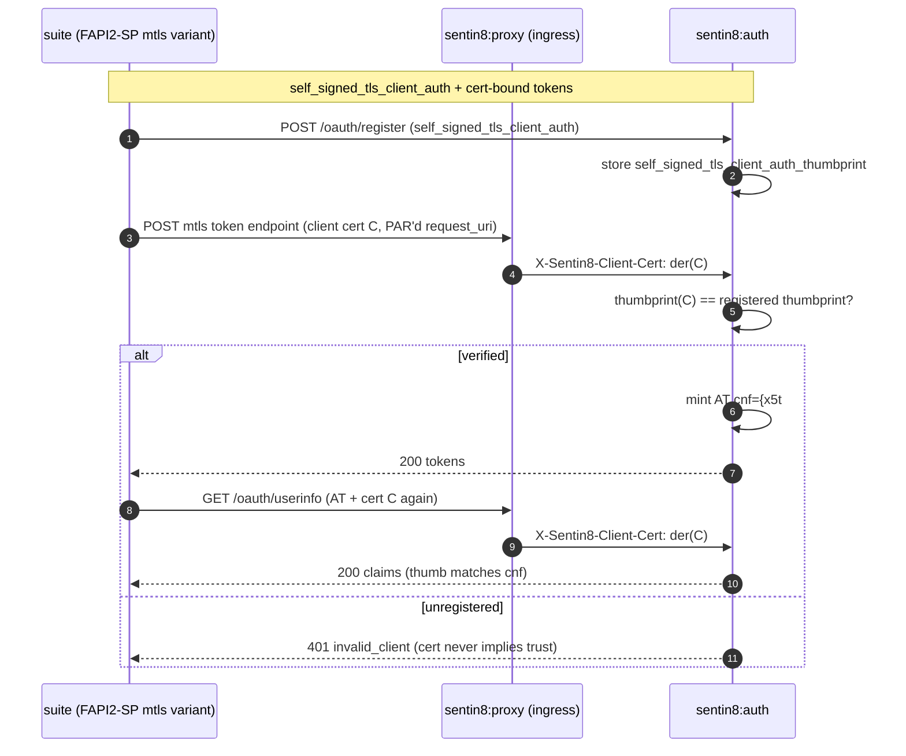

**Target-state refinements (proven in the certification run).** (a) The
mTLS branch selection is keyed on the REGISTRATION, never on which
identity headers arrived: `tls_client_auth` compares the subject DN,
`self_signed_tls_client_auth` compares the presented thumbprint; a
missing cert under a registered mTLS method is
`401 client authentication required`. (b) `require_dpop` is a
SENDER-CONSTRAINT requirement, satisfied by either mechanism: a
client authenticated via mTLS (a present `cert_thumbprint`) needs no
DPoP proof - the two constraints are mutually exclusive per RFC 8705
§2-3 and RFC 9449; a DPoP proof sent anyway still verifies and
binds `cnf.jkt`. (c) `tls_client_certificate_bound_access_tokens: true`
is a PLATFORM capability advertised unconditionally (the mTLS
endpoint ALIASES stay `require_mtls`-gated - the routes, not the
capability, follow the profile). (d) The discovery verification
(`CheckTLSClientCertificateBoundAccessTokensTrue`) and the full
static-client config validation chain (the suite's PEMFormatter
decodes `config.mtls.cert|key` / `config.mtls2.cert|key` AS base64 -
the seed publishes the base64(DER) forms; the section CA is
mandatory in practice) run to terminal
with zero warnings. LIVE RESULT: both FAPI2-SP cells terminal-green
(the dpop cell 52 modules; the mtls cell 37 modules: 63 PASSED /
24 REVIEW (suite by-design screenshot confirms) / 1 SKIP-SANCTIONED
(RS256-assertion; ES256 client) / 1 FAIL-SANCTIONED (multi-DPoP
suite JVM collapse; server negative proven at the wire) - zero
warnings, zero interrupts).

### 9a.13 Hybrid + implicit response types (the OIDC family)

The certification family runs variant cells per `response_type`: the
Basic plan's `code` cell, the RP-Initiated-Logout plan's `code` AND
`id_token` cells, and the form-post/hybrid plans (the same five). The
target state:
1. discovery advertises the standard five
   (`code`, `id_token`, `code id_token`, `id_token token`,
   `code id_token token`) - the advertised set answers the suite's
   metadata allow-list per plan cell.
2. The authorize handler validates the five (space-split, exact
   membership) and encodes EVERY response carrying a `token`/`id_token`
   member in the URL FRAGMENT (OAuth-RT-5 - an error under an implicit
   cell also redirects to the fragment).
3. The hybrid id_token mint rides the standard
   `id_token_with_details` (c_hash + s_hash exist, §9a.3); the
   code-record stamps the cell's response_type (the exchange validates
   the presented type against the stamped one). PAR + JAR overlay the
   same validation (the request object's `response_type` follows the
   same five).

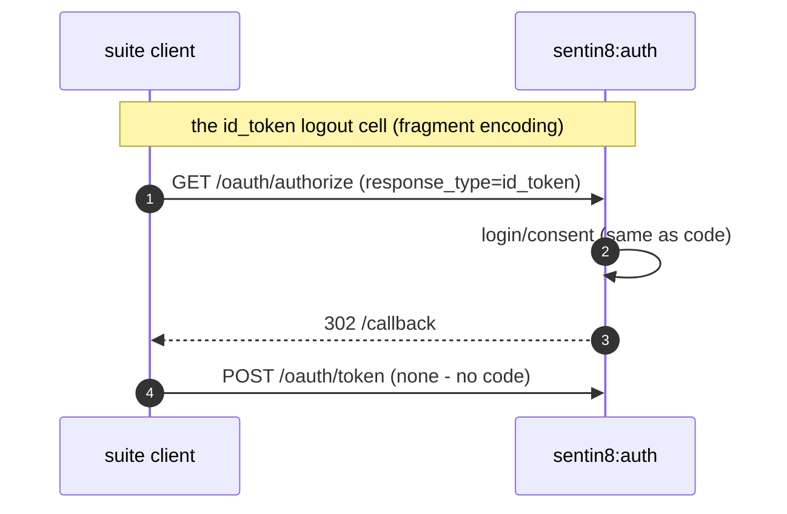

## 10. Open Questions

- SAML flows beyond metadata/ACS are a declared non-goal for the platform IdP
  (enterprise SSO is served by OIDC federation).
- Status List keeps the per-credential bit (standard model: verifiers fetch
  the credential status); fleet-wide aggregation is out of scope.
- Webhook delivery gains a DLQ replay surface mirroring post's `replay_dlq`
  shape (`POST /v1/admin/webhooks/attempts/{id}/replay`).
- Push-based identity invalidation is already implemented as events
  (`sentin8:sys:identity:updated`); role resolvers subscribe instead of
  relying only on TTL polling.

> JWKS rotation is internal: a daily in-process timer (03:00, 30-day
> staleness gate) calls the in-process rotate path directly - auth links
> no scheduler client and makes no cross-service calls (SDD §2.5, root
> service rule).

### 9a.14 FAPI 1 Advanced final (plain_fapi / private_key_jwt / pushed / JARM)

The FAPI1-Advanced plan drives the JAR-only push shape end to end; the
wire-level deltas beyond §9a.11-§9a.13:

- **Cipher-profile gate** (`SENTIN8_TLS_CIPHER_PROFILE=fapi`, sentin8-tls
  v0.6.13): the suite's FAPI_TLS_1_2_CIPHERS = TLS 1.2
  {DHE_RSA_{128,256}, ECDHE_RSA_{128,256}} + TLS 1.3
  {AES_256_GCM, CHACHA20}; the provider retains exactly the suites the
  graviola EC-leaf can serve (ECDHE_RSA members + the TLS 1.3 pair).
  Non-permitted suites (AES-128-GCM TLS 1.3, ECDHE_ECDSA, CBC/CCM) fail
  at the handshake - FAPI1-ADV-8.5-1's `DisallowInsecureCipher` family.
- **PAR JAR-only push**: the form layer is `request` +
  `client_assertion`(+type) only; `response_type` / `client_id` /
  `redirect_uri` / `response_mode` resolve FROM the verified request
  object. Defect objects reject `invalid_request_object`: scope-less
  (FAPI1-ADV 7.1), exp/nbf out of range (±10 min), wrong audience,
  nested `request_uri` (RFC 9101 §6). Client assertion audiences
  (RFC 7523): the issuer string, any OAuth endpoint URL, or an array
  containing one of those.
- **Presented-certificate binding (RFC 8705 §3)**: the token mint binds
  `cnf.x5t#S256` from the TLS-presented client certificate regardless of
  the registered auth method - an mTLS-connected request on the mtls
  alias yields a certificate-bound token (the FAPI1 planes: the token
  endpoint IS certificate-checked even for `private_key_jwt` clients).
- **JARM response shape**: `iss` = the host-resolved issuer (§9a.4), the
  JWT signed with the PROFILE's `signing_alg` (ES256 in the FAPI
  postures), both success and the `access_denied` deny path wrapped, and
  the `response` parameter appended with `&` when the registered
  redirect already carries a query. The mtls-aliased token/introspect/
  revoke responses carry `Cache-Control: no-store` (RFC 6749 §5.1).

### 9a.15 FAPI CIBA ID1 (poll + ping, static_client / private_key_jwt)

The full `fapi-ciba-id1-test-plan` runs in TWO cells (ciba_mode poll | ping) -
34 + 39 modules, every module terminal (PASSED | sanctioned SKIPPED | by-design
REVIEW with the screenshot uploaded) at zero warnings.

**Contract (bc-authorize, CIBA §7.1).** FAPI-CIBA pushes carry ONLY
`request` + `client_assertion` + `client_assertion_type` - the form client_id is
OPTIONAL and resolves from the first of: the form value, the verified client
assertion's `iss`, the request object's `client_id` claim. The **signed request
object is mandatory**; its claims are authoritative:

- `iss` == the authenticated client_id (REQUIRED);
- `aud` includes the AS: issuer | `{issuer}/oauth/token` |
  `{issuer}/oauth/bc-authorize` (REQUIRED);
- `exp` in (-5min, +1h), `iat` in (-1d, +5min), `nbf` in (-10min, +5min)
  (REQUIRED each; the suite's negative modules bound these windows);
- `jti` a non-empty string.
  Every defect answers HTTP 400 with an RFC 6749 JSON body
  (`{"error": "invalid_request"[, "error_description"]}`) - rendered by
  `CibaAuthzError`, which splits the `"{code}: {description}"` payload.
  Client-authentication failures (401) render `invalid_client`; the
  `client_assertion_type` MUST be exactly
  `urn:ietf:params:oauth:client-assertion-type:jwt-bearer` when an assertion
  is presented; exactly ONE hint parameter
  (login_hint | login_hint_token | id_token_hint | sub) is accepted; the
  header `alg` must not be `none`, HS*, or RS256 (FAPI's PS/ES-only rule).

**Grant semantics (handle_ciba_token, CIBA §11).** The poll's gate order:
valkey record lookup (missing key = TTL-expired = `expired_token`) -> client
match (polling client == the grant's client; foreign clients answer
`invalid_grant` BEFORE any status answer) -> holder-of-key certificate check
(below) -> status gates: `pending` -> `authorization_pending`, `denied` ->
`access_denied`, `consumed` -> `invalid_grant` (single-use). After a successful
mint the record flips to `consumed` (kept 90s) - a reuse poll answers
`invalid_grant`, a genuinely TTL-ed-out one answers `expired_token`.
`auth_req_id` concatenates two UUIDs (256 bits - the suite's recommended
>=160).

**Holder-of-key (CIBA §11.2).** When the client authenticated with a client
certificate, `bc_authorize` binds the presented thumbprint to the grant
(`mtls_thumb` in the valkey record); every poll must present the SAME
certificate - a certless (or different-cert) poll rejects `invalid_grant`
before any status answer. The minted access token also carries the `cnf`
binding (9a.14 (19)).

**Ping delivery (CIBA §5.2).** Ping vs poll is signaled by the CLIENT: a
request carrying `client_notification_token` (and no explicit `request_mode`)
is a PING request. At approval time the OP POSTs `{"auth_req_id": ...}` with
the token as Bearer to the client's registered
`backchannel_client_notification_endpoint` - the ping response's redirect
(3xx) is NOT followed (CIBA-10.2: `reqwest::redirect::Policy::none()`). The
registration's backchannel endpoint is read under the SYSTEM env RLS context
(the `with_client_env` pattern - a bare pool query sees zero rows because
`auth.oauth_clients` is env-RLS gated; the same context the authorize/PAR paths
use). Certification: the registered endpoint is the suite's
`/test/a/{alias}/ciba-notification-endpoint` (NOT the callback path - the
suite's ping receiver resolves the WAITING module from the request).

**Harness (sentin8-auth-oidf).** The runner's CIBA hook drives the out-of-band
user approval: sign-in with the cert user -> `POST /v1/ciba/approve`
(`{auth_req_id, approved: true|false}`) per observed auth_req_id - the
dedicated approval endpoint resolves the ping delivery
(`assisted/{id}/complete` would always approve without notifying). Two DISTINCT
seed clients (ciba | ciba2, each with its own P-256 jwks) satisfy the
multiple-client family (signed-by-other-client / bad-iss). The seed's fapi_ciba
profile registers both CIBA clients with the suite's ping URL.

### 9a.16 FAPI 2.0 Message Signing (final plan, dpop + mtls cells)

The `fapi2-message-signing-final-test-plan` (FAPI2MessageSigningFinalTestPlan)
runs in TWO cells (client_auth_type=private_key_jwt + sender_constrain=dpop,
and self_signed_tls_client_auth + mtls) - 66 variant modules each, every module
terminal (PASSED | zero-failure REVIEW | sanctioned SKIPPED | the one
suite-client-known-limitation FAIL) at zero warnings.

**Plan anatomy (what "message signing" means here).** The FINAL plan's
"request signing" axis (`fapi_request_method=signed_non_repudiation`) is the
SIGNED REQUEST OBJECT (RFC 9101 JAR) pushed through PAR - NOT RFC 9421 HTTP
message signatures on the token endpoint: the happy flow POSTs a PLAIN token
request and expects 200, and the suite's signature negatives exercise the JAR
algorithm family (`ensure-signed-request-object-with-RS256-fails` and the
client-assertion RS256 negative). The OP therefore keeps
`require_http_signatures: false` for the `fapi_2_message_signing` posture -
the flag stays reserved for a future RFC 9421-speaking plan.

**Security posture (`fapi_2_message_signing`).** Identical to `fapi_2`
(§9a.14): PAR + JARM + DPoP-required + `iss` response parameter + PS/ES-only
JOSE + strict aud in client assertions + 60s code lifetime - with
`require_jwt_introspection: false` (the plan does not exercise RFC 9701
signed introspection).

**Strict audience policy (profile-scoped).** `verify_client_assertion`'s
audience acceptance is resolved PER REQUEST from the env security profile:

- FAPI 2.0 postures (`fapi_2` | `fapi_2_message_signing`): `aud` must be the
  issuer EXACTLY (string). A single-member array naming the issuer is
  tolerated; every endpoint-form audience (`{issuer}/oauth/token`,
  `{issuer}/oauth/par`, the mtls alias) and the two-member array negative are
  rejected 400/401 (`invalid_client`/`invalid_request` per the suite's
  `CheckErrorFromParEndpointResponseError...` family).
- FAPI 1 Advanced (and standard/CIBA): the permissive RFC 7523/9126 set -
  issuer or any of the issuer's OAuth endpoints, array contains-any. The
  fapi1-advanced plan's audience-ARRAY/endpoint-audience modules REQUIRE the
  permissive form, so the policy cannot be globally strict.

**PAR `dpop_jkt` pre-binding (RFC 9449 §10.1).** `JarClaims` carries
`dpop_jkt`; the PAR handler extracts it from the (still-unverified) request
object form BEFORE the DPoP-proof gate, ORs it with the form parameter (the
JAR value wins), persists it in the PAR record, and at token time enforces
the DPoP proof's key thumbprint == the pre-bound `dpop_jkt` (mismatch 400
`invalid_dpop_proof` "DPoP proof key does not match the pre-bound dpop_jkt").
Ordering matters: full JAR signature verification still happens after the
proof gate, so a forged request object cannot smuggle a jkt past an unvalidated
signature.

**The dpop-negative wire contract.** The server side of the
"more than one DPoP in the header" negative is implemented and proven at the
wire: `extract_dpop_header` counts `get_all("dpop")` entries - two header
lines OR one comma-joined value yield `None`, and the cnf.jkt gate answers
401. The module itself lands FAIL-SANCTIONED: the suite's JVM client collapses
the two stored proofs into ONE wire header before send (verified by proxy
wire capture - the proxy faithfully `append`s both lines; the collapse is in
the test client), so the RS legitimately answers 200 to the
single-valid-proof request that actually arrives. The OP behavior is correct;
the client cannot send the negative shape.

**PS256 (RSASSA-PSS) acceptance.** RFC 7518 §3.5 makes PS256 the
FAPI-mandated RSA signing form, and the discovery documents already advertised
it for request objects - so the verify set MUST make every advertised member
verifiable (§9a.10 honesty). `SigningKeys::verify_with_jwk` gains the
`("RSA", "PS256")` arm (jsonwebtoken `Algorithm::PS256` - PSS, salt = the
SHA-256 digest size) alongside RS256; `verify_raw_with_jwk` gains the PSS
arm for signature-base artifacts (`rsa::pss::VerifyingKey`); and
`token_endpoint_auth_signing_alg_values_supported` now advertises
`{active_signing_alg, PS256, ES256}`. An RSA-keyed client may sign client
assertions, request objects, and HTTP-signature bases with PS256; the ES-keyed
RS256 negatives still reject (unsupported key/alg combination). A
PS256 round-trip unit test proves the path.

**Certification status.** dpop cell terminal: 77 PASSED, 36 REVIEW
(failures=0, warnings=0 - the suite's by-design manual-review states:
PAR-reuse family, PKCE-required family, expired-request_uri family), 3
SKIP-SANCTIONED (ES256-client RS256 negatives - our alg policy is PS/ES and
the suite blesses the skip), 1 FAIL-SANCTIONED (above), zero warnings.

---

---

**Design attribution:** sentin8:auth and its underlying concepts were designed by Hamid Jahanzad <Hamid@Jahanzad.com>.
