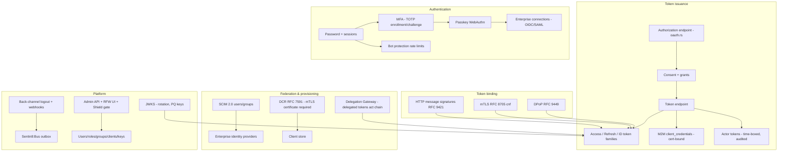

# Design Doc: Sentin8:Auth - Identity, OAuth/OIDC & Authorization Issuer

## 1. Summary

Sentin8:Auth is the platform's single identity plane: the only issuer,
JWKS authority, and authentication authority. It implements the
OAuth 2.0 / OIDC core (all grant families), sender-constrained tokens
(DPoP, mTLS, RFC 8705), financial-grade profiles (FAPI 2.0), modern
attenuation formats (SD-JWT/VC), passkey and MFA authentication, SCIM
provisioning, enterprise federation, CIBA, dynamic client registration,
the Delegation Gateway, actor tokens, admin surfaces, and webhooks.
Every other service verifies tokens it issues; no service mints its own.

## 2. Motivation

- **One authority or none.** Multiple issuers would fragment trust,
  key distribution, and audit. Every token in the platform
  (user, ID, refresh, M2M, API-client, actor, delegated) comes from
  this service and verifies against its JWKS.
- **Cert-bound by default.** M2M tokens are certificate-bound
  (RFC 8705 `cnf`) so a stolen token without the private key is
  useless; DCR requires an mTLS client certificate - there is no
  plaintext credential M2M path.
- **Authorization is decided live.** The JWT `scope` claim is a
  coarse pre-filter and RLS feed; the decision belongs to Shield
  (Sentin8:Policy) against roles resolved LIVE - no `roles`/`groups`
  claim in the token, so role changes take effect on the next request.
- **Conformance is a feature.** FAPI 2.0, OIDC conformance profiles,
  JAR/JARM, DPoP, and SD-JWT are implemented as first-class modes, not
  best-effort approximations - the platform targets regulated verticals.
- **OIDF certification is a program, not an event.** The OIDF conformance
  suite runs locally against a dedicated rig (classical TLS/RS256 lens over
  the same protocol logic) as the gate before any certification submission.
  Scope: OIDC Basic/Config/Dynamic + RP-Initiated/Back-Channel Logout,
  FAPI 2 (Security Profile + Message Signing), FAPI 1 Advanced, FAPI-CIBA
  (poll + ping), OID4VCI/OID4VP, and eKYC-IDA. Excluded by design: Implicit
  and Hybrid OP (deprecated response types), Front-Channel Logout (tracking
  surface). See `DESIGN.md` §9a.

## 3. Architecture & High-Level Design

- **Grant surface** - authorization-code (+PKCE), refresh, device code,
  CIBA (decoupled approval), client_credentials (M2M), and token
  exchange - each profile-gated by the caller's resolved security
  profile (FAPI 2.0 default).
- **Authentication surface** - password sessions, MFA (TOTP), passkeys,
  enterprise federation (OIDC/SAML connections), app passwords,
  sentin8or (admin assistant) flows, and bot protection on public
  endpoints.
- **Authorization pipeline** - extract bearer → verify
  (issuer/signature/expiry/audience/token type) → resolve tenant →
  feature gate → authorize via Shield → set RLS context → execute →
  audit. Requests that cannot resolve a tenant context are rejected.
- **Admin surface** - full CRUD over users, roles (with nesting),
  groups, OAuth clients, API keys, sessions, memberships, and
  invitations; every mutation emits a domain event through the local
  outbox (same transaction).

## 4. Key Traits and Data Structures

- **`SigningKeys`** - the platform signing key set (including
  post-quantum families) backing both the JWKS document and minted
  JWTs; rotation is coordinated through the JWKS cache TTL.
- **`AuthContext`** - the verified bearer + claims surface every other
  service consumes via the shared auth-client SDK; `sub`, tenant ids,
  scopes, and token type.
- **`Sentin8orAuthContext`** - verified token + tenant context for
  platform-assistant requests, resolving the managed org from the
  token's env claim (delegated tokens carry the target org).
- **`TokenError` / `OAuthTokenError`** - the protocol error taxonomy
  (invalid_grant, invalid_client, …) mapped onto HTTP responses.
- **`SdJwtError`** - SD-JWT verification failures safe to surface
  (malformed, hash mismatch, duplicate disclosure, key binding,
  revoked, status list).
- **`AccessMode`** - the read/write scope split: GET endpoints accept
  `read` OR `write`; mutating endpoints require `write`.
- **Grant records** - standing consent, idempotent per
  (env, user, client): an existing active grant is widened/narrowed
  instead of duplicated, and carries the `grant_id` embedded in minted
  tokens (revocation cascade).

## 5. Rationale, Trade-offs, and Alternatives

- **No realm, no embedded roles.** A user is a user; platform operator
  vs. bank teller vs. retail customer differ only in RBAC assignments.
  Embedding roles in the JWT would freeze authorization at issuance
  time; Shield resolving roles live means a demoted admin loses access
  on their next request, not at token expiry.
- **mTLS as the only M2M registration path.** DCR for M2M workloads
  requires a client certificate - the certificate is the bootstrap
  credential, and the minted token is bound to it (`cnf`). A
  `client_secret` path for M2M would recreate the plaintext-credential
  cache problem the platform retired.
- **Grant-bound token minting.** Every user-facing token issuance
  records/updates a standing consent grant first and embeds its id;
  token revocation cascades through the grant. The alternative
  (revoking tokens individually) leaves orphaned access paths.
- **Transaction-local RLS everywhere.** Every tenant statement runs on
  a connection where the context was set inside the same explicit
  transaction - the context is transaction-local, so split-batch or
  autocommit patterns silently filter all rows (this invariant is
  enforced in grant recording, admin listing, and session flows).
- **CIBA approval binds to the session.** The approving user is the
  session's user; `user_id`/`org_id`/`env_id` in the body are ignored
  (kept as legacy wire fields for the authenticator app). Client
  authentication on the backchannel endpoint is mandatory for
  confidential clients.
- **Security profiles resolve per request.** The security profile
  (env → org → platform fallback chain; the env row is authoritative)
  determines which OIDC fields to include and which grant types are
  allowed - FAPI 2.0 is the default posture. A global profile would
  force the strictest profile platform-wide.
- **TOTP secrets encrypted, not hashed.** The server must recover the
  secret to generate competing codes on drift windows; AES-256-GCM
  envelope encryption with the platform master key is the compromise,
  with a dev-only deterministic key escape hatch for tests.
- **Passkeys and passwords coexist.** WebAuthn is offered as an
  authentication factor, not a replacement - enterprise users may be
  behind IdPs without passkey support; MFA (TOTP) covers the
  second-factor gap where passkeys are not enrolled.
- **SCIM for enterprise identity.** IdP-driven provisioning (create /
  update / deactivate users, groups) uses SCIM 2.0 so workforce
  directories sync without bespoke connectors.
- **Events through the local outbox.** Every lifecycle change
  (user/role/group/client/apikey/session/membership created, updated,
  deleted, revoked, terminated) writes an outbox row in the same
  transaction - the Bus relay publishes it; a Bus outage never loses
  an event.
- **Rejected: JWT `roles`/`groups` claims.** Token bloat, stale
  authorization, and a second source of truth; Shield resolves live.
- **Rejected: per-vertical login services.** Identity is one plane;
  vertical-specific UX composes over the same flows (hosted pages,
  overlays) rather than forks.

## 6. Internal Implementation & Invariants (Private Design)

- **Invariants:**
  - Only Sentin8:Auth mints tokens; no other service has a JWKS.
  - `is_platform_admin` is permission-based: `scope` contains
    `sys:admin`; group/role tables are never queried at request time.
  - M2M tokens carry `token_tp: "m2m"` and are certificate-bound
    (`cnf`) by default; the mTLS thumbprint binds the token to the
    client certificate.
  - Hostname-based tenant resolution fallback is an explicitly
    disabled-by-default escape hatch (env-flag gated) - the TLS context
    headers are the primary tenant source; the fallback warns loudly.
  - CIBA and device flows are session- and client-bound; approval
    cannot be replayed across sessions.
  - Refresh tokens are rotated and revocable; a consumed refresh token
    invalidates its family (reuse detection).
  - Webhook deliveries and audit events ride the durable outbox, never
    fire-and-forget HTTP.
  - Admin listings (users, sessions, grants) always resolve the tenant
    from the caller's token context inside one transaction with the
    context set - cross-env requires the target env in the token.
- **Boot.** Config from `SENTIN8_AUTH_*`; signing keys loaded/rotated
  via the JWKS module; PQ crypto provider installed before any TLS;
  Shield boot loads ONE engine shared with the request path; the shell
  owns the listener and middleware stack.
- **DPoP.** Access-token requests carry an SSE proof JWT (`htm`, `hti`,
  `ath` binding); the server validates the key thumbprint binding and
  binds the proof's public key hash into the token.
- **Wallet / SD-JWT.** Key-binding check uses the embedded `jwk` +
  `sd_hash`; status lists are fetched and enforced (revocation);
  QES signature ceremonies are delegated to the bank8-payments
  integration (endpoint returns NOT IMPLEMENTED until that lands).

## 7. Unresolved Questions / Future Designs

- Continuous access evaluation: session/token revocations already push
  `sentin8:auth:session:revoked` to the BFF session-reaper (DESIGN §10) so
  cached sessions die immediately; risk-signal gating of NEW token issuance
  layers on top of live authorization (Shield resolves roles per request
  already).
- Hardware-backed key attestation is deferred: the WebAuthn `attestation`
  conveyance preference is the seam.
- Native OIDC conformance runs are scheduled per profile in priority order
  (Core → Basic OP → fapi).
- Multi-region active-active issuer deployment is a non-goal until
  multi-region exists; the JWKS overlap-rotation design is region-safe.
- SCIM `/Bulk` is live (AUTH-5, RFC 7644 §3.7): a thin wrapper over the
  per-user SQL paths (create/replace/delete; ≤100 ops; `failOnErrors`
  stops the batch). The precondition consumer exists - BFF's delegated
  SCIM proxy (`/delegate/scim/*`, scopes `sentin8:scim:read/write`) is
  the enterprise IdP path.

---

**Design attribution:** sentin8:auth and its underlying concepts were designed by Hamid Jahanzad <Hamid@Jahanzad.com>.
