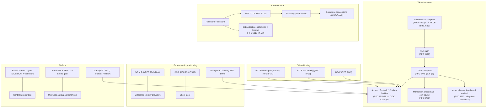

# Sentin8:Auth - Identity, OAuth/OIDC & Authorization Issuer

## 1. Summary

Sentin8:Auth is the platform's single identity plane: the only issuer,
JWKS authority, and authentication authority. It implements the OAuth
2.0 core ([RFC 6749](https://datatracker.ietf.org/doc/html/rfc6749)) and
OpenID Connect
([OIDC Core](https://openid.net/specs/openid-connect-core-1_0.html))
across every grant family, sender-constrained tokens — DPoP
([RFC 9449](https://datatracker.ietf.org/doc/html/rfc9449)) and mTLS
certificate binding ([RFC 8705](https://datatracker.ietf.org/doc/html/rfc8705)) —
financial-grade profiles (FAPI 2.0, [FAPI 2.0
SP](https://openid.net/specs/fapi-2_0-security-profile.html); FAPI 1
Advanced, [FAPI 1.0 part
2](https://openid.net/specs/openid-financial-api-part-2.html)), modern
credential formats (SD-JWT/VC +
[Status List](https://www.ietf.org/archive/id/draft-ietf-oauth-status-list-14.html)),
passkey ([WebAuthn](https://www.w3.org/TR/webauthn-3/)) and MFA
([RFC 6238](https://datatracker.ietf.org/doc/html/rfc6238))
authentication, SCIM provisioning ([RFC 7643](https://datatracker.ietf.org/doc/html/rfc7643)
/ [RFC 7644](https://datatracker.ietf.org/doc/html/rfc7644)), enterprise
federation, CIBA
([CIBA](https://openid.net/specs/openid-client-initiated-backchannel-authentication-core-1_0.html)),
dynamic client registration ([RFC 7591](https://datatracker.ietf.org/doc/html/rfc7591)
/ [RFC 7592](https://datatracker.ietf.org/doc/html/rfc7592)), the
Delegation Gateway ([RFC 8693](https://datatracker.ietf.org/doc/html/rfc8693)),
actor tokens, admin surfaces, and webhooks. Every other service verifies
tokens it issues; no service mints its own. The complete standards
register with per-mechanism anchors is `DESIGN.md` §12.

## 2. Motivation

- **One authority or none.** Multiple issuers would fragment trust,
  key distribution, and audit. Every token in the platform
  (user, ID, refresh, API-client, actor, delegated) comes from
  this service and verifies against its JWKS — the single-issuer
  property FAPI requires
  ([FAPI 2.0 SP §5](https://openid.net/specs/fapi-2_0-security-profile.html)).
- **Sender-constrained by default.** M2M tokens are certificate-bound
  (RFC 8705 `cnf`) so a stolen token without the private key is
  useless; user tokens are DPoP-bound under the default profile; DCR
  requires an mTLS client certificate — there is no plaintext
  credential M2M path (OAuth threat model, RFC 6819 §4.4).
- **Authorization is decided live.** The JWT `scope` claim is a coarse
  pre-filter and RLS feed (RFC 6749 §3.3 semantics); the decision
  belongs to Shield against roles resolved LIVE - no `roles`/`groups`
  claim in the token, so role changes take effect on the next request.
- **Cert-bound by design out of band.** Platform workloads
  authenticate with NO token at all (TLS client-certificate identity,
  §4.3f) — the certificate is the service identity.
- **Conformance is a feature.** JAR
  ([RFC 9101](https://datatracker.ietf.org/doc/html/rfc9101)), PAR
  ([RFC 9126](https://datatracker.ietf.org/doc/html/rfc9126)), JARM,
  DPoP, mTLS, and SD-JWT are first-class modes, not best-effort
  approximations — the platform targets regulated verticals.
- **OIDF certification is a program, not an event.** The OIDF
  conformance suite runs locally against a dedicated rig as the gate
  before any certification submission. Scope: OIDC Basic/Config/Dynamic
  + RP-Initiated/Back-Channel Logout, FAPI 2 (Security Profile +
  Message Signing), FAPI 1 Advanced, FAPI-CIBA (poll + ping), OID4VCI
  ([Issuer](https://openid.net/specs/openid-4-verifiable-credential-issuance-1_0.html)),
  OID4VP
  ([Verifier](https://openid.net/specs/openid-4-verifiable-presentations-1_0.html)),
  and eKYC-IDA
  ([§5](https://openid.net/specs/openid-connect-ida-1_0.html)). Excluded
  by design: Implicit and Hybrid OP (deprecated response types),
  Front-Channel Logout (tracking surface). See `DESIGN.md` §9a.

## 3. Architecture & High-Level Design

- **Grant surface** — authorization-code (+PKCE), refresh, device code
  ([RFC 8628](https://datatracker.ietf.org/doc/html/rfc8628)), CIBA
  (decoupled approval + poll/ping), client_credentials (M2M), and token
  exchange ([RFC 8693](https://datatracker.ietf.org/doc/html/rfc8693)) —
  each profile-gated by the caller's resolved security profile (FAPI 2.0
  default).
- **Authorization surface** — PAR pushes
  ([RFC 9126](https://datatracker.ietf.org/doc/html/rfc9126)), signed
  request objects ([RFC 9101](https://datatracker.ietf.org/doc/html/rfc9101)),
  JARM signed response modes, resource indicators
  ([RFC 8707](https://datatracker.ietf.org/doc/html/rfc8707)), rich
  authorization requests ([RFC 9396](https://datatracker.ietf.org/doc/html/rfc9396)),
  native-app redirect rules ([RFC 8252](https://datatracker.ietf.org/doc/html/rfc8252)).
- **Authorization pipeline** — extract bearer (RFC 6750 §2.2) → verify
  (issuer/signature/expiry/audience/token type) → resolve tenant →
  feature gate → authorize via Shield → set RLS context → execute →
  audit. Requests that cannot resolve a tenant context are rejected.
- **Wallet surface** — OID4VCI issuer (§9a.7 of `DESIGN.md`): issuer
  metadata, `/oauth/credential`, §7.2.1 identifier form, issuance nonce
  (§8.1), batch issuance (§7.3), deferred polling, notifications, and
  signed status lists; OID4VP verifier (§11); SD-JWT verification with
  key binding and status enforcement.
- **Admin surface** — full CRUD over users, roles (with nesting),
  groups, OAuth clients, API keys, sessions, memberships, and
  invitations; every mutation emits a domain event through the local
  outbox (same transaction).

Wire-level detail, data model, and failure modes: `DESIGN.md` §2-§6.
Route inventory with per-family spec anchors: `DESIGN.md` §10.

## 4. Key Traits and Data Structures

- **`SigningKeys`** - the platform signing key set (ML-DSA-65 / RS256 /
  ES256-verify) backing both the JWKS document
  ([RFC 7517](https://datatracker.ietf.org/doc/html/rfc7517)) and minted
  JWTs ([RFC 7515](https://datatracker.ietf.org/doc/html/rfc7515));
  rotation is insert-new-key overlap coordinated through cache TTLs.
- **`AuthContext`** - the verified bearer + claims surface every other
  service consumes via the shared auth-client SDK; `sub`, tenant ids,
  scopes, and token type (`token_tp` per the token-family table,
  `DESIGN.md` §2).
- **`Sentin8orAuthContext`** - verified token + tenant context for
  platform-assistant requests, resolving the managed org from the
  token's env claim (delegated tokens carry the target org).
- **`TokenError` / `OAuthTokenError`** - the protocol error taxonomy
  mapped onto RFC 6749 §5.2 responses (`invalid_grant`,
  `invalid_client`, …); uniform shapes (no existence oracle, §8).
- **`SdJwtError`** - SD-JWT verification failures safe to surface
  (malformed, hash mismatch, duplicate disclosure, key binding,
  revoked, status list).
- **`AccessMode`** - the read/write scope split: GET endpoints accept
  `read` OR `write`; mutating endpoints require `write`.
- **Grant records** - standing consent (FAPI 2.0 Grant Management),
  idempotent per (env, user, client); an existing active grant is
  widened/narrowed instead of duplicated and carries the `grant_id`
  embedded in minted tokens (revocation cascade).

## 5. Rationale, Trade-offs, and Alternatives

- **No realm, no embedded roles.** A user is a user; platform operator
  vs. bank teller vs. retail customer differ only in RBAC assignments.
  Embedding roles in the JWT would freeze authorization at issuance
  time; Shield resolving roles live means a demoted admin loses access
  on their next request, not at token expiry.
- **mTLS as the only M2M registration path.** DCR for M2M workloads
  requires a client certificate ([RFC 8705](https://datatracker.ietf.org/doc/html/rfc8705)) -
  the certificate is the bootstrap credential, and the minted token is
  bound to it (`cnf.x5t#S256`). A `client_secret` path for M2M would
  recreate the plaintext-credential cache problem the platform retired.
- **Grant-bound token minting.** Every user-facing token issuance
  records/updates a standing consent grant first and embeds its id;
  token revocation cascades through the grant. The alternative
  (revoking tokens individually) leaves orphaned access paths
  (RFC 7009 §2.1 recommendation).
- **Transaction-local RLS everywhere.** Every tenant statement runs on
  a connection where the context was set inside the same explicit
  transaction - the context is transaction-local, so split-batch or
  autocommit patterns silently filter all rows.
- **CIBA approval binds to the session** (CIBA §13 security
  considerations). The approving user is the session's user;
  `user_id`/`org_id`/`env_id` in the body are ignored. Client
  authentication on the backchannel endpoint is mandatory for
  confidential clients (CIBA §5).
- **Security profiles resolve per request.** The security profile (env →
  org → platform fallback chain; the env row is authoritative)
  determines which OIDC fields to include and which grant types are
  allowed - FAPI 2.0 is the default posture. A global profile would
  force the strictest profile platform-wide.
- **TOTP secrets encrypted, not hashed** (RFC 6238 §5.1 requires
  symmetric verification; drift-window re-generation needs the secret).
  AES-256-GCM envelope encryption with the platform master key is the
  compromise, with a dev-only deterministic key escape hatch for tests.
- **Passkeys and passwords coexist.** WebAuthn is offered as an
  authentication factor, not a replacement - enterprise users may be
  behind IdPs without passkey support; MFA (TOTP) covers the
  second-factor gap where passkeys are not enrolled.
- **SCIM for enterprise identity** (RFC 7644 semantics). IdP-driven
  provisioning (create / update / deactivate users, groups) uses SCIM 2.0
  so workforce directories sync without bespoke connectors.
- **Events through the local outbox.** Every lifecycle change writes an
  outbox row in the same transaction - the Bus relay publishes it; a Bus
  outage never loses an event (durable-change-signal plane).
- **Rejected: JWT `roles`/`groups` claims.** Token bloat, stale
  authorization, and a second source of truth; Shield resolves live.
- **Rejected: per-vertical login services.** Identity is one plane;
  vertical-specific UX composes over the same flows rather than forks.

## 6. Internal Implementation & Invariants (Private Design)

Invariants (full numbered list in `DESIGN.md` §8):

- Only Sentin8:Auth mints tokens; no other service has a JWKS.
- `is_platform_admin` is permission-based: `scope` contains `sys:admin`;
  group/role tables are never queried at request time.
- M2M tokens carry `token_tp: "m2m"` and are certificate-bound (`cnf`) by
  default; the mTLS thumbprint binds the token to the client certificate.
- Hostname-based tenant-resolution fallback is an explicitly
  disabled-by-default escape hatch - the TLS context headers are the
  primary tenant source; the fallback warns loudly.
- CIBA and device flows are session- and client-bound; approval cannot
  be replayed across sessions.
- Refresh tokens are rotated and revocable; a consumed refresh token
  invalidates its family (reuse detection → `invalid_grant`).
- Webhook deliveries and audit events ride the durable outbox, never
  fire-and-forget HTTP.
- Admin listings always resolve the tenant from the caller's token
  context inside one transaction with the context set - cross-env
  requires the target env in the token.
- **DPoP jti replay cache is keyed on thumbprint·jti** (RFC 9449 §4.4) -
  a global jti cache would let one client suppress another's proofs.
- **DCR secrets are never logged or echoed** outside the initial
  registration response (RFC 7591 §5.3.1).

- **Boot.** Config from `SENTIN8_AUTH_*`; signing keys loaded via the
  JWKS module; PQ crypto provider installed before any TLS; Shield boots
  ONE engine shared with the request path; the shell owns the listener
  and middleware stack.
- **DPoP.** Proofs carry `htm`, `htu`, `iat`, `jti`, and `ath` where the
  token is bound; the server validates `cnf.jkt` (RFC 7638) and rejects
  replayed jti within the window.
- **Wallet / SD-JWT.** Key-binding check uses the embedded `jwk` +
  `sd_hash`; status lists are fetched and enforced (revocation, Status
  List draft); QES signature ceremonies are delegated to the bank8
  integration (endpoint returns NOT IMPLEMENTED until then).

## 7. Unresolved Questions / Future Designs

- Continuous access evaluation: session/token revocations already push
  `sentin8:auth:session:revoked` to the BFF session-reaper so cached
  sessions die immediately; risk-signal gating of NEW token issuance is
  the next layer on top of live authorization.
- Hardware-backed key attestation is deferred: the WebAuthn `attestation`
  conveyance preference is the seam; OID4VCI App. D attestation verify
  accepts software-key attestations today (x5c self-consistency).
- Handshake-level certificate revocation (CERTFREE-2) is a platform-level
  follow-up.
- Multi-region active-active issuer deployment is a non-goal until
  multi-region exists; the JWKS overlap-rotation design is region-safe.
- SCIM `/Bulk` is live (RFC 7644 §3.7): a thin wrapper over the per-user
  SQL paths (≤100 ops; `failOnErrors` stops the batch); BFF's delegated
  SCIM proxy is the enterprise IdP path.

---

**Architecture & Design:** sentin8:auth and its underlying concepts were
designed by [Hamid Jahanzad](https://www.linkedin.com/in/hamidjahanzad/).